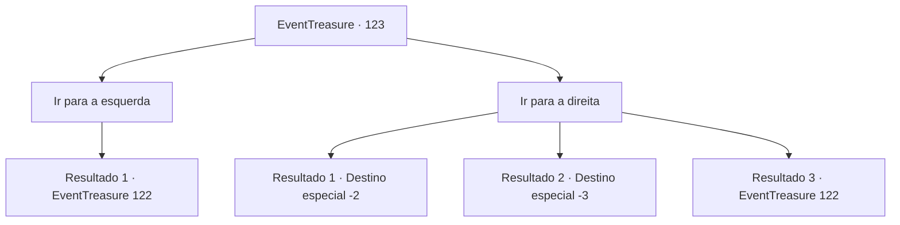

# Eventos de tesouro · 123

[Índice da tabela](index.md) · [Índice geral](../index.md)

ID: `pt:EventTreasure:123` · Fonte: `EventTreasure4` · Versão: 1.2.47.

Mapeamento estático dos arquivos; a disponibilidade e a execução dependem do estado da run.

## Texto do evento

*Sem texto no arquivo.*

## Dados de entrada

```json
{
  "id": 123,
  "grade": 1,
  "place": "",
  "required": ""
}
```

## Mapa das escolhas



## Escolhas e resultados

### Escolha 1

Ir para a esquerda

Requisitos e outros campos da escolha:

```json
{
  "required": ""
}
```

#### Resultado 1.1

Ao entrar no portão esquerdo, você encontra alguém sentado ao lado de uma mesa de chá, no meio de um enorme prado.  Seu corpo é transparente, como se ele fosse feito de névoa. Ele tem um queixo pontudo e um par de presas.  Ao observá-lo, você ouve a voz dele ecoando em sua cabeça.  

 "Bem vindo. Aqui, sente-se."

  Ele então estala os dedos.  Em um instante, você é teletransportado para a frente dele, também sentado na mesa de chá.  

 "É bom ver você, aventureiro. Parabéns à sua inteligência e sabedoria. Aqui, esta é a sua recompensa."

  Ele então gentilmente empurra duas xícaras de chá para você, cada uma contendo chá vermelho e chá verde, respectivamente.

Continuação registrada: [Evento 122](0122.md) na mesma tabela.

```json
{
  "required": "",
  "chance": "1",
  "nextEvent": 122,
  "type": 2,
  "reward": ""
}
```

### Escolha 2

Ir para a direita

Requisitos e outros campos da escolha:

```json
{
  "required": ""
}
```

#### Resultado 2.1

Ao entrar no portão direito, você é engolido pela escuridão. O lugar parece estar absorvendo som. Ele até absorve o som da sua respiração, e você consegue ouvir o seu coração batendo nos seus ouvidos. A escuridão te aperta como uma cobra. O aperto fica cada vez mais forte, e começa a ficar difícil respirar. Você começa a ouvir diversos palavrões, incapaz de identificar de onde eles estão vindo. <link=shake><color=purple>

 "!@%$$%^$#&&(%^$#)#$"

</color></link> Quando você recupera a consciência, você se encontra de volta ao lugar onde estão os golens e os portões.

Continuação registrada: [Destino especial `-2`](../destinos-especiais.md).

```json
{
  "required": "1_1_2|18_271_2",
  "chance": "1",
  "nextEvent": -2,
  "type": 2,
  "reward": "0_14_-1|0_1_-1"
}
```

#### Resultado 2.2

Ao entrar no portão direito, você é engolido pela escuridão.  O lugar parece estar absorvendo som. Ele até absorve o som da sua respiração, e você consegue ouvir o seu coração batendo nos seus ouvidos.  A escuridão te aperta como uma cobra.  O aperto fica cada vez mais forte, e começa a ficar difícil respirar. Você começa a ouvir diversos palavrões, incapaz de identificar de onde eles estão vindo.  <link=shake><color=purple>

 "!@%$$%^$#&&(%^$#)#$"

</color></link>  Quando você recupera a consciência, você se encontra de volta ao lugar onde estão os golens e os portões.

Continuação registrada: [Destino especial `-3`](../destinos-especiais.md).

```json
{
  "required": "2_1_2|18_271_2",
  "chance": "1",
  "nextEvent": -3,
  "type": 2,
  "reward": "0_14_-1|0_1_-1"
}
```

#### Resultado 2.3

Você segue para o portão direito, mas o golem bloqueia você.  Em seguida, ele o pega do chão e o atira para o portão esquerdo.  Ao entrar no portão esquerdo, você encontra alguém sentado ao lado de uma mesa de chá, no meio de um enorme prado.  Seu corpo é transparente, como se ele fosse feito de névoa. Ele tem um queixo pontudo e um par de presas.  Ao observá-lo, você ouve a voz dele ecoando em sua cabeça.  

 "Bem vindo. Aqui, sente-se."

  Ele então estala os dedos.  Em um instante, você é teletransportado para a frente dele, também sentado na mesa de chá.  

 "É bom ver você, aventureiro. Parabéns à sua inteligência e sabedoria. Aqui, esta é a sua recompensa."

  Ele então gentilmente empurra duas xícaras de chá para você, cada uma contendo chá vermelho e chá verde, respectivamente.

Continuação registrada: [Evento 122](0122.md) na mesma tabela.

```json
{
  "required": "5_271_2",
  "chance": "1",
  "nextEvent": 122,
  "type": 2,
  "reward": ""
}
```

## Referências que chegam a este evento

- [Evento 120 · escolha 2 · resultado 1](0120.md#escolha-2)
- [Evento 120 · escolha 3 · resultado 1](0120.md#escolha-3)
