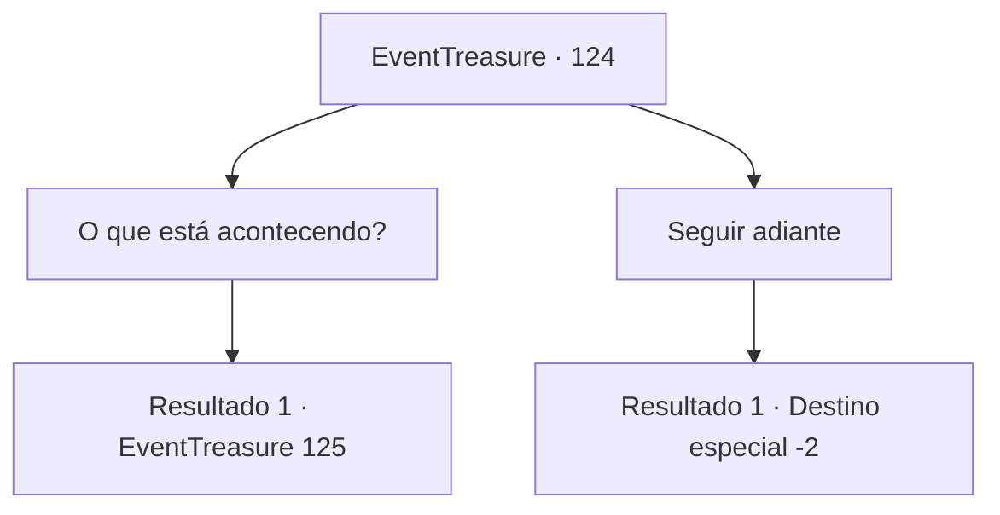

# Eventos de tesouro · 124

[Índice da tabela](index.md) · [Índice geral](../index.md)

ID: `pt:EventTreasure:124` · Fonte: `EventTreasure4` · Versão: 1.2.47.

Mapeamento estático dos arquivos; a disponibilidade e a execução dependem do estado da run.

## Texto do evento

Você passa por uma pequena cidade chamada 'Águas Ferventes'. O lugar é famoso por uma fonte termal que ferve até no meio das nevascas mais frias. Mas você não vê tantos turistas. Os habitantes da cidade estão rezando em frente a uma torre grande de pedras empilhadas. Parece que a torre foi construída pelos próprios habitantes. A torre de pedra, quando vista de perto, é feita de pedras pretas empilhadas umas sobre as outras, e você percebe que as rochas são na verdade carvão.

## Dados de entrada

```json
{
  "id": 124,
  "grade": 1,
  "place": "",
  "required": "5_273_0"
}
```

## Mapa das escolhas



## Escolhas e resultados

### Escolha 1

O que está acontecendo?

Requisitos e outros campos da escolha:

```json
{
  "required": ""
}
```

#### Resultado 1.1

Quando você pergunta o que está acontecendo, uma idosa, cujo rosto mostra sua velhice, responde. 

 "O símbolo da nossa cidade... a fonte termal fervente... não está mais fervendo. A água esfriou e estamos perdendo turistas a cada minuto ... Se não consertarmos isso logo, todos aqui morrerão de fome. Por isso, estamos orando aos deuses."

 Então, uma menina se aproxima de você e sussurra. 

 "Aventureiro, você tem um minuto de sobra?"


Continuação registrada: [Evento 125](0125.md) na mesma tabela.

```json
{
  "required": "",
  "chance": "1",
  "nextEvent": 125,
  "type": 2,
  "reward": "5_273_1"
}
```

### Escolha 2

Seguir adiante

Requisitos e outros campos da escolha:

```json
{
  "required": ""
}
```

#### Resultado 2.1

Você dá uma olhada na torre de pedra e nas pessoas ao redor dela, vira-se e segue para outro lugar.

Continuação registrada: [Destino especial `-2`](../destinos-especiais.md).

```json
{
  "required": "",
  "chance": "1",
  "nextEvent": -2,
  "type": 2,
  "reward": "5_273_9"
}
```

## Referências que chegam a este evento

Nenhum `nextEvent` positivo da mesma tabela aponta para este nó. Isso não prova que seja inacessível: sorteio e estado de história podem selecioná-lo.

