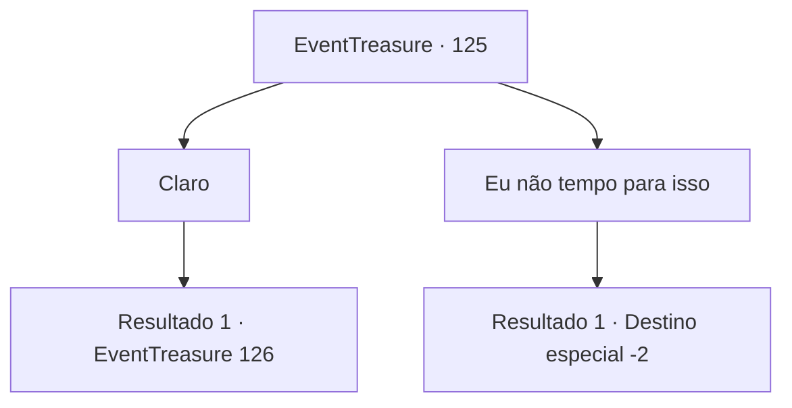

# Eventos de tesouro · 125

[Índice da tabela](index.md) · [Índice geral](../index.md)

ID: `pt:EventTreasure:125` · Fonte: `EventTreasure4` · Versão: 1.2.47.

Mapeamento estático dos arquivos; a disponibilidade e a execução dependem do estado da run.

## Texto do evento

*Sem texto no arquivo.*

## Dados de entrada

```json
{
  "id": 125,
  "grade": 1,
  "place": "",
  "required": ""
}
```

## Mapa das escolhas



## Escolhas e resultados

### Escolha 1

Claro

Requisitos e outros campos da escolha:

```json
{
  "required": ""
}
```

#### Resultado 1.1

Você se afasta da multidão, seguindo a garotinha.  Ela olha em volta, procurando outras pessoas, e sussurra baixinho após perceber que não há ninguém ali.  

 "Não acho que orar aos deuses seja a solução. Eu tenho um plano... você se importaria de me ajudar?"


Continuação registrada: [Evento 126](0126.md) na mesma tabela.

```json
{
  "required": "",
  "chance": "1",
  "nextEvent": 126,
  "type": 2,
  "reward": ""
}
```

### Escolha 2

Eu não tempo para isso

Requisitos e outros campos da escolha:

```json
{
  "required": ""
}
```

#### Resultado 2.1

Decepcionada, a menina vai embora.  Você dá uma olhada na torre de pedra e na oração dos habitantes da cidade, antes de se virar e ir embora.

Continuação registrada: [Destino especial `-2`](../destinos-especiais.md).

```json
{
  "required": "",
  "chance": "1",
  "nextEvent": -2,
  "type": 2,
  "reward": "5_273_9"
}
```

## Referências que chegam a este evento

- [Evento 124 · escolha 1 · resultado 1](0124.md#escolha-1)
