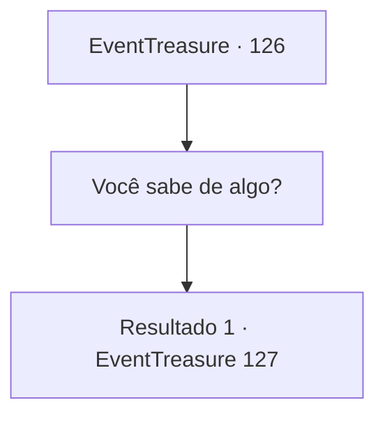

# Eventos de tesouro · 126

[Índice da tabela](index.md) · [Índice geral](../index.md)

ID: `pt:EventTreasure:126` · Fonte: `EventTreasure4` · Versão: 1.2.47.

Mapeamento estático dos arquivos; a disponibilidade e a execução dependem do estado da run.

## Texto do evento

*Sem texto no arquivo.*

## Dados de entrada

```json
{
  "id": 126,
  "grade": 1,
  "place": "",
  "required": ""
}
```

## Mapa das escolhas



## Escolhas e resultados

### Escolha 1

Você sabe de algo?

Requisitos e outros campos da escolha:

```json
{
  "required": ""
}
```

#### Resultado 1.1

Ela agarra suas mangas e o leva para as planícies atrás da cidade. Há um enorme fosso, com pedrinhas espalhadas em um padrão como se fossem pegadas. Ela fala, olhando para o fosso. 

 "Estive lá uma vez..."

 Ela então puxa um pequeno pedaço de pergaminho. No pergaminho há um desenho rudimentar, mas muito informativo, do interior do fosso. |drawing_pitPicture| Ela aponta para o desenho, dizendo que acha que o poço está conectado ao fundo da fonte termal. A teoria dela é que 'algo' tem esquentado a fonte termal todo esse tempo, e que ela precisa da sua ajuda para encontrar essa 'coisa' que escapou.

Continuação registrada: [Evento 127](0127.md) na mesma tabela.

```json
{
  "required": "",
  "chance": "1",
  "nextEvent": 127,
  "type": 2,
  "reward": ""
}
```

## Referências que chegam a este evento

- [Evento 125 · escolha 1 · resultado 1](0125.md#escolha-1)
