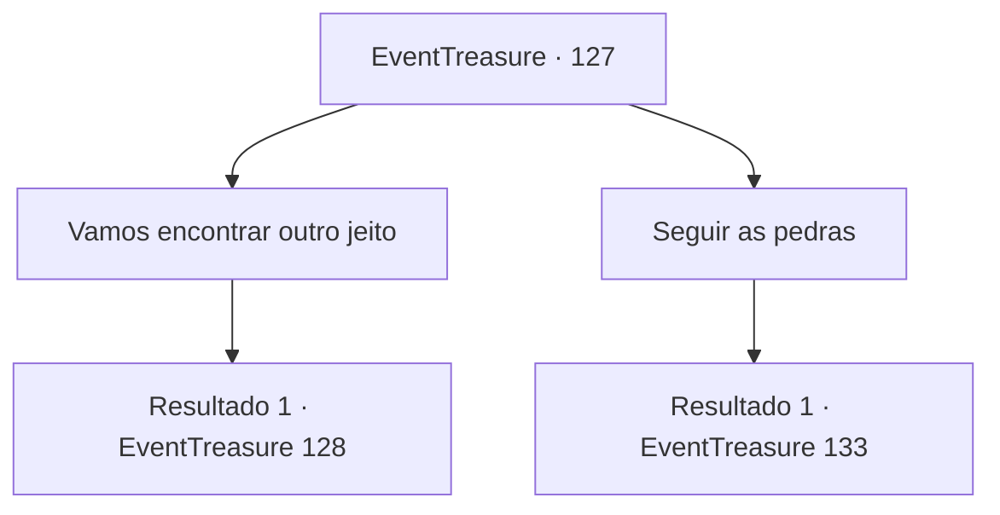

# Eventos de tesouro · 127

[Índice da tabela](index.md) · [Índice geral](../index.md)

ID: `pt:EventTreasure:127` · Fonte: `EventTreasure4` · Versão: 1.2.47.

Mapeamento estático dos arquivos; a disponibilidade e a execução dependem do estado da run.

## Texto do evento

*Sem texto no arquivo.*

## Dados de entrada

```json
{
  "id": 127,
  "grade": 1,
  "place": "",
  "required": ""
}
```

## Mapa das escolhas



## Escolhas e resultados

### Escolha 1

Vamos encontrar outro jeito

Requisitos e outros campos da escolha:

```json
{
  "required": "1_14_10"
}
```

#### Resultado 1.1

Você se lembra da torre de pedra na aldeia. Sua hipótese é que se você trouxer os blocos de carvão daquela torre, colocá-los no fosso e acendê-los, a fonte ficará quente novamente. A menina parece preocupada com a sua ideia. Ainda assim, você se aproxima do povo da cidade orando na torre de pedra. Você então diz a eles que essas 'pedras' devem ser movidas para outro lugar. Então, a idosa de antes grita com você, furiosa. 

 "O que..! Você está nos pedindo para remover a torre de pedra? Devemos orar de todo o nosso coração! Isso é ultrajante!"

 Os outros habitantes da cidade concordam com a cabeça.

Continuação registrada: [Evento 128](0128.md) na mesma tabela.

```json
{
  "required": "",
  "chance": "1",
  "nextEvent": 128,
  "type": 2,
  "reward": ""
}
```

### Escolha 2

Seguir as pedras

Requisitos e outros campos da escolha:

```json
{
  "required": ""
}
```

#### Resultado 2.1

Você segue o caminho das pedras.  Após cerca de uma hora de caminhada, você sente que está ficando cada vez mais quente.  Logo você percebe que realmente estava ficando mais quente.  Um golem de lava está caminhando, na sua frente.

Continuação registrada: [Evento 133](0133.md) na mesma tabela.

```json
{
  "required": "",
  "chance": "1",
  "nextEvent": 133,
  "type": 2,
  "reward": ""
}
```

## Referências que chegam a este evento

- [Evento 126 · escolha 1 · resultado 1](0126.md#escolha-1)
