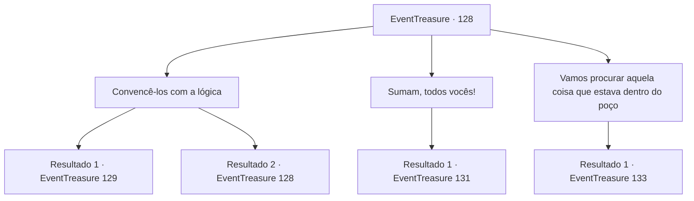

# Eventos de tesouro · 128

[Índice da tabela](index.md) · [Índice geral](../index.md)

ID: `pt:EventTreasure:128` · Fonte: `EventTreasure4` · Versão: 1.2.47.

Mapeamento estático dos arquivos; a disponibilidade e a execução dependem do estado da run.

## Texto do evento

*Sem texto no arquivo.*

## Dados de entrada

```json
{
  "id": 128,
  "grade": 1,
  "place": "",
  "required": ""
}
```

## Mapa das escolhas



## Escolhas e resultados

### Escolha 1

Convencê-los com a lógica

Requisitos e outros campos da escolha:

```json
{
  "required": "5_275_0"
}
```

#### Resultado 1.1

Você explica a estrutura do fosso para os habitantes da cidade, com o desenho feito pela menina como prova. Você diz a eles que, se eles acenderem o poço com carvão, a fonte de água quente voltará a ferver. A idosa ainda parece insatisfeita, mas os outros habitantes da cidade mexem a cabeça, concordando com sua explicação lógica. Um deles fala alto. 

 "Certo. Não temos outra opção, de qualquer maneira, então vamos tentar."

 Você e os habitantes da cidade carregam o carvão para o fosso. Com a ajuda de todos, logo toda a torre de pedra foi jogada no fosso. 

 "Lá vai..."

 O que falou acende um fósforo e o joga na pilha de carvão. A pilha começa a pegar fogo. Logo você vê a fumaça saindo. Todos fogem do fosso para evitar a fumaça, indo direto para a fonte termal.

Continuação registrada: [Evento 129](0129.md) na mesma tabela.

```json
{
  "required": "",
  "chance": "1|0_7_1",
  "nextEvent": 129,
  "type": 0,
  "reward": ""
}
```

#### Resultado 1.2

Você tenta convencer o povo da cidade, mas ninguém o escuta.  Sua abordagem lógica falha, e agora você deve encontrar outra maneira.

Continuação registrada: [Evento 128](0128.md) na mesma tabela.

```json
{
  "required": "",
  "chance": "18",
  "nextEvent": 128,
  "type": 1,
  "reward": "5_275_1"
}
```

### Escolha 2

Sumam, todos vocês!

Requisitos e outros campos da escolha:

```json
{
  "required": ""
}
```

#### Resultado 2.1

Você grita com as pessoas da cidade, empurrando-as para longe da torre.  Elas começam a se afastar da torre, e você carrega a pilha de carvão e vai para o poço.  

  A garotinha ajuda você a mover o carvão, mas ainda assim leva muito tempo.  Ela abre a boca, olhando para a pilha de carvão no poço.  

 "Ok... agora o que nós devemos fazer?"


Continuação registrada: [Evento 131](0131.md) na mesma tabela.

```json
{
  "required": "",
  "chance": "1",
  "nextEvent": 131,
  "type": 2,
  "reward": ""
}
```

### Escolha 3

Vamos procurar aquela coisa que estava dentro do poço

Requisitos e outros campos da escolha:

```json
{
  "required": ""
}
```

#### Resultado 3.1

Você desiste de convencer as pessoas da cidade e volta para o poço.  Você então segue o caminho das pedras.  Após cerca de uma hora de caminhada, você sente que está ficando cada vez mais quente.  Logo você percebe que realmente estava ficando mais quente.  Um golem de lava está andando, na sua frente.

Continuação registrada: [Evento 133](0133.md) na mesma tabela.

```json
{
  "required": "",
  "chance": "1",
  "nextEvent": 133,
  "type": 2,
  "reward": ""
}
```

## Referências que chegam a este evento

- [Evento 127 · escolha 1 · resultado 1](0127.md#escolha-1)
- [Evento 128 · escolha 1 · resultado 2](0128.md#escolha-1)
