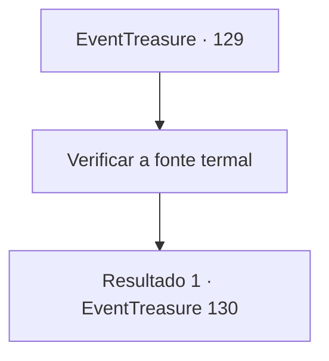

# Eventos de tesouro · 129

[Índice da tabela](index.md) · [Índice geral](../index.md)

ID: `pt:EventTreasure:129` · Fonte: `EventTreasure4` · Versão: 1.2.47.

Mapeamento estático dos arquivos; a disponibilidade e a execução dependem do estado da run.

## Texto do evento

*Sem texto no arquivo.*

## Dados de entrada

```json
{
  "id": 129,
  "grade": 1,
  "place": "",
  "required": ""
}
```

## Mapa das escolhas



## Escolhas e resultados

### Escolha 1

Verificar a fonte termal

Requisitos e outros campos da escolha:

```json
{
  "required": ""
}
```

#### Resultado 1.1

Você e os habitantes da cidade vão para a fonte termal. Mas o que acontece depois não corresponde às expectativas de todos. A velha te agarra e te sacode, gritando. 

 "S... Seu maldito idiota! Você está feliz agora? Você condenou nossa cidade para sempre...!!!"

 Só então, você vê o vapor saindo da fonte termal. Você não é o único que percebe isso. 

 "Olhe para a fonte termal!!"

 Agora todo mundo está olhando para a fonte termal, junto com o vapor que sai dela. A velha deixa você ir, se aproxima da fonte termal e mergulha na água. 

 "Está quente... Acho que não foi à toa. Mas ainda assim, não está fervendo!"

 Ela olha para você brevemente antes de entrar em sua casa.

Continuação registrada: [Evento 130](0130.md) na mesma tabela.

```json
{
  "required": "",
  "chance": "1",
  "nextEvent": 130,
  "type": 2,
  "reward": ""
}
```

## Referências que chegam a este evento

- [Evento 128 · escolha 1 · resultado 1](0128.md#escolha-1)
