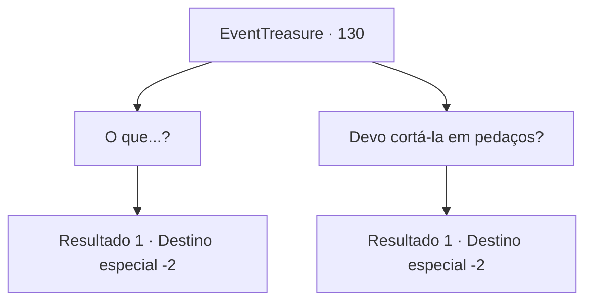

# Eventos de tesouro · 130

[Índice da tabela](index.md) · [Índice geral](../index.md)

ID: `pt:EventTreasure:130` · Fonte: `EventTreasure4` · Versão: 1.2.47.

Mapeamento estático dos arquivos; a disponibilidade e a execução dependem do estado da run.

## Texto do evento

*Sem texto no arquivo.*

## Dados de entrada

```json
{
  "id": 130,
  "grade": 1,
  "place": "",
  "required": ""
}
```

## Mapa das escolhas



## Escolhas e resultados

### Escolha 1

O que...?

Requisitos e outros campos da escolha:

```json
{
  "required": ""
}
```

#### Resultado 1.1

A garotinha se aproxima de você e explica. 

 "Se ao menos tivéssemos mais daquelas pedras pretas... Peço desculpas por você ter que lidar com a vovó. Ela pode ser um pé no saco às vezes. Obrigado novamente por ajudar nossa cidade."

 Então as outras pessoas da cidade também começam a agradecer você. Eles também trazem para você seus sinais de apreço, coisas de valor coletadas em suas casas. Você sai da cidade, acompanhado pelas pessoas da cidade termal.

Continuação registrada: [Destino especial `-2`](../destinos-especiais.md).

```json
{
  "required": "",
  "chance": "1",
  "nextEvent": -2,
  "type": 2,
  "reward": "3_144_1|3_191_1|0_4_50|0_2_1"
}
```

### Escolha 2

 Devo cortá-la em pedaços?

Requisitos e outros campos da escolha:

```json
{
  "required": "2_3_0"
}
```

#### Resultado 2.1

Você sente suas mãos coçando por uma luta. Esses fracotes do campo não devem ser um desafio para você. Então, a garotinha de antes pega sua mão e fala. 

 "Se ao menos tivéssemos mais daquelas pedras pretas... Peço desculpas por você ter que lidar com a vovó. Ela pode ser um pé no saco às vezes . Obrigado novamente por ajudar nossa cidade."

 Então as outras pessoas da cidade também começam a agradecer você. Eles também trazem para você seus sinais de apreço, coisas de valor coletadas em suas casas. Você sai da cidade, acompanhado pelas pessoas da cidade termal.

Continuação registrada: [Destino especial `-2`](../destinos-especiais.md).

```json
{
  "required": "",
  "chance": "1",
  "nextEvent": -2,
  "type": 2,
  "reward": "3_144_1|3_191_1|0_4_50|0_2_1"
}
```

## Referências que chegam a este evento

- [Evento 129 · escolha 1 · resultado 1](0129.md#escolha-1)
