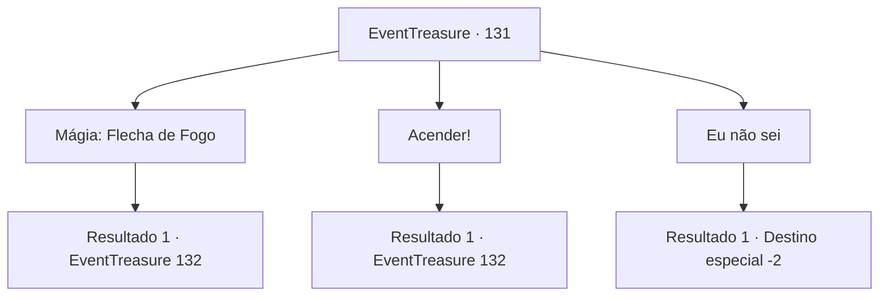

# Eventos de tesouro · 131

[Índice da tabela](index.md) · [Índice geral](../index.md)

ID: `pt:EventTreasure:131` · Fonte: `EventTreasure4` · Versão: 1.2.47.

Mapeamento estático dos arquivos; a disponibilidade e a execução dependem do estado da run.

## Texto do evento

*Sem texto no arquivo.*

## Dados de entrada

```json
{
  "id": 131,
  "grade": 1,
  "place": "",
  "required": ""
}
```

## Mapa das escolhas



## Escolhas e resultados

### Escolha 1

Mágia: Flecha de Fogo

Requisitos e outros campos da escolha:

```json
{
  "required": "20_0_1"
}
```

#### Resultado 1.1

Você lança um feitiço e cria uma flecha de fogo. Ela voa direto para a pilha de carvão, acendendo-a. A garotinha exclama com admiração. 

 "Uau...!!"

 Mas logo, a fumaça do fogo força você e a garota a sair do poço. Você percebe que suas mãos estão limpas, embora tenha visto com seus próprios olhos, a garota carregando um pouco do carvão. 

 "Podemos ir ver a fonte termal agora?"

 Antes que você possa responder, ela corre na direção da fonte termal.

Continuação registrada: [Evento 132](0132.md) na mesma tabela.

```json
{
  "required": "",
  "chance": "1",
  "nextEvent": 132,
  "type": 2,
  "reward": ""
}
```

### Escolha 2

Acender!

Requisitos e outros campos da escolha:

```json
{
  "required": "23_3_1"
}
```

#### Resultado 2.1

Você acende uma fogueira e acende a pilha de carvão. A garotinha exclama com admiração. 

 "Uau...!!"

 Mas logo, a fumaça do fogo força você e a garota a sair do poço. Você percebe que suas mãos estão limpas, embora tenha visto com seus próprios olhos, a garota carregando um pouco do carvão. 

 "Podemos ir ver a fonte termal agora?"

 Antes que você possa responder, ela corre na direção da fonte termal.

Continuação registrada: [Evento 132](0132.md) na mesma tabela.

```json
{
  "required": "",
  "chance": "1",
  "nextEvent": 132,
  "type": 2,
  "reward": ""
}
```

### Escolha 3

Eu não sei

Requisitos e outros campos da escolha:

```json
{
  "required": ""
}
```

#### Resultado 3.1

Você dá de ombros e sai do poço. A garota murmura para si mesma que o carvão não deveria ficar aqui, mas você a ignora e vai embora.

Continuação registrada: [Destino especial `-2`](../destinos-especiais.md).

```json
{
  "required": "",
  "chance": "1",
  "nextEvent": -2,
  "type": 2,
  "reward": ""
}
```

## Referências que chegam a este evento

- [Evento 128 · escolha 2 · resultado 1](0128.md#escolha-2)
