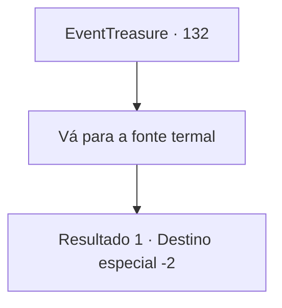

# Eventos de tesouro · 132

[Índice da tabela](index.md) · [Índice geral](../index.md)

ID: `pt:EventTreasure:132` · Fonte: `EventTreasure4` · Versão: 1.2.47.

Mapeamento estático dos arquivos; a disponibilidade e a execução dependem do estado da run.

## Texto do evento

*Sem texto no arquivo.*

## Dados de entrada

```json
{
  "id": 132,
  "grade": 1,
  "place": "",
  "required": ""
}
```

## Mapa das escolhas



## Escolhas e resultados

### Escolha 1

Vá para a fonte termal

Requisitos e outros campos da escolha:

```json
{
  "required": ""
}
```

#### Resultado 1.1

Depois de um tempo, quando você chega à fonte termal, a água está quente novamente. Você vê o vapor subindo da fonte termal. Felizmente o plano parece ter funcionado. Você não é o único que vê isso. 

 "Olha, a fonte termal!"

 Agora todo mundo está olhando para a fonte termal, junto com o vapor que sai dela. A garota sorri, vendo as pessoas da cidade felizes novamente. Ela então lhe entrega um pequeno elemental da água, acrescentando que é a coisa mais preciosa que ela tem. 

 "Eu peguei enquanto estava brincando na cidade. É um presente de agradecimento!"

 Você quer saber se uma coisa como esta pode ser encontrada enquanto 'brinca'. Mas quando você olha para a garota para perguntar isso, ela está longe de ser encontrada. Você coça a nuca em confusão e sai da cidade termal.

Continuação registrada: [Destino especial `-2`](../destinos-especiais.md).

```json
{
  "required": "",
  "chance": "1",
  "nextEvent": -2,
  "type": 2,
  "reward": "3_192_1|0_2_1"
}
```

## Referências que chegam a este evento

- [Evento 131 · escolha 1 · resultado 1](0131.md#escolha-1)
- [Evento 131 · escolha 2 · resultado 1](0131.md#escolha-2)
