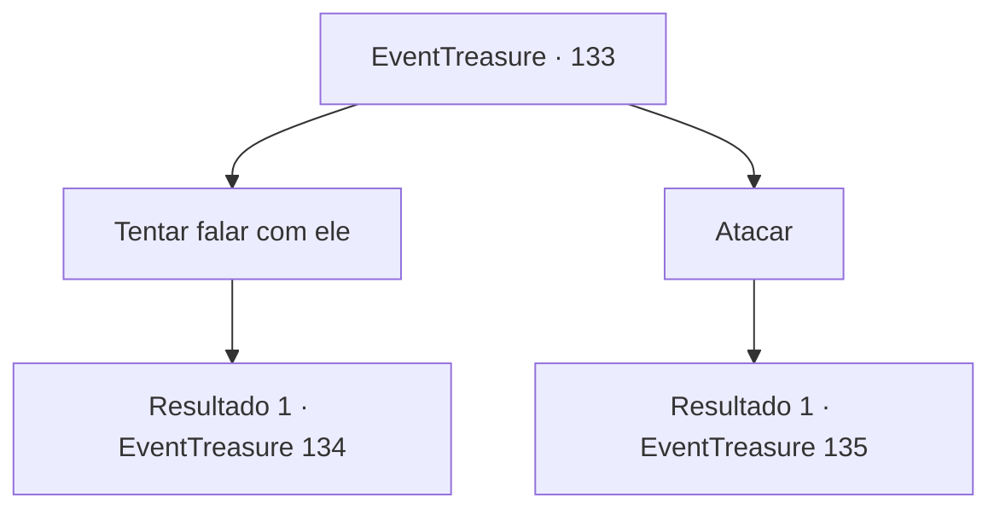

# Eventos de tesouro · 133

[Índice da tabela](index.md) · [Índice geral](../index.md)

ID: `pt:EventTreasure:133` · Fonte: `EventTreasure4` · Versão: 1.2.47.

Mapeamento estático dos arquivos; a disponibilidade e a execução dependem do estado da run.

## Texto do evento

*Sem texto no arquivo.*

## Dados de entrada

```json
{
  "id": 133,
  "grade": 1,
  "place": "",
  "required": ""
}
```

## Mapa das escolhas



## Escolhas e resultados

### Escolha 1

Tentar falar com ele

Requisitos e outros campos da escolha:

```json
{
  "required": ""
}
```

#### Resultado 1.1

Você bloqueia o golem de lava e fala. O enorme golem de lava inclina a cabeça. Parece estar esperando você falar.

Continuação registrada: [Evento 134](0134.md) na mesma tabela.

```json
{
  "required": "",
  "chance": "1",
  "nextEvent": 134,
  "type": 2,
  "reward": ""
}
```

### Escolha 2

Atacar

Requisitos e outros campos da escolha:

```json
{
  "required": ""
}
```

#### Resultado 2.1

Você pega sua arma e ataca o golem de lava.

Continuação registrada: [Evento 135](0135.md) na mesma tabela.

```json
{
  "required": "",
  "chance": "1",
  "nextEvent": 135,
  "type": 2,
  "reward": "6_0_17",
  "place": 2
}
```

## Referências que chegam a este evento

- [Evento 127 · escolha 2 · resultado 1](0127.md#escolha-2)
- [Evento 128 · escolha 3 · resultado 1](0128.md#escolha-3)
