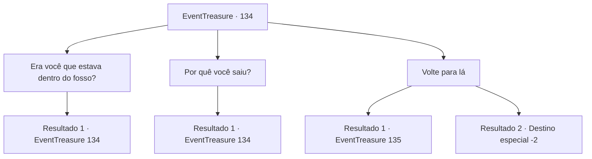

# Eventos de tesouro · 134

[Índice da tabela](index.md) · [Índice geral](../index.md)

ID: `pt:EventTreasure:134` · Fonte: `EventTreasure4` · Versão: 1.2.47.

Mapeamento estático dos arquivos; a disponibilidade e a execução dependem do estado da run.

## Texto do evento

*Sem texto no arquivo.*

## Dados de entrada

```json
{
  "id": 134,
  "grade": 1,
  "place": "",
  "required": ""
}
```

## Mapa das escolhas



## Escolhas e resultados

### Escolha 1

Era você que estava dentro do fosso?

Requisitos e outros campos da escolha:

```json
{
  "required": "5_274_0"
}
```

#### Resultado 1.1

Você pergunta ao golem de lava se é aquele que ficou dentro do poço. O golem de lava acena com a cabeça, lava escorrendo dele.

Continuação registrada: [Evento 134](0134.md) na mesma tabela.

```json
{
  "required": "",
  "chance": "1",
  "nextEvent": 134,
  "type": 2,
  "reward": "5_274_1"
}
```

### Escolha 2

Por quê você saiu?

Requisitos e outros campos da escolha:

```json
{
  "required": "5_274_1"
}
```

#### Resultado 2.1

Quando você pergunta por que de repente saiu do poço, ele olha para você por um longo tempo antes de responder. 

 "O pedido expirou. A encomenda que recebi. Fique dentro do poço. Esse tempo acabou."

 Quando o golem termina suas palavras, a garotinha fala. 

 "Hm... Ouvi dizer que há muito tempo, um mago chamado 'Hans' criou uma fonte termal para sua filha, que sofria muito com o frio..."

 Aparentemente, o ingrediente que o mago usou para a fonte termal é aquele golem de lava.

Continuação registrada: [Evento 134](0134.md) na mesma tabela.

```json
{
  "required": "",
  "chance": "1",
  "nextEvent": 134,
  "type": 2,
  "reward": "5_274_2"
}
```

### Escolha 3

Volte para lá

Requisitos e outros campos da escolha:

```json
{
  "required": "5_274_2"
}
```

#### Resultado 3.1

Você diz ao golem de lava que ele deve retornar ao poço. Mas o golem te ignora completamente e levanta seus punhos em chamas.

Continuação registrada: [Evento 135](0135.md) na mesma tabela.

```json
{
  "required": "21_0_3",
  "chance": "1",
  "nextEvent": 135,
  "type": 2,
  "reward": "6_0_17",
  "place": 2
}
```

#### Resultado 3.2

Você entende a estrutura da magia que alimenta o golem de lava. Você infunde um pouco de sua própria energia mágica, fixando seus comandos. O golem de lava então se vira lentamente, voltando para o poço. A menina olha para você com olhos brilhantes. 

 "Uau..! Aventureiro... Eu não sabia que você sabia usar magia! Agora a fonte termal deve estar de volta à vida!!"

 A garotinha pula de alegria. Ela então lhe entrega um pequeno elemental da água, dizendo que é o presente dela. 

 "Eu peguei quando estava brincando na cidade. É um presente de agradecimento!"

 Você quer saber se uma coisa como esta pode ser encontrada enquanto 'se brinca'. Mas quando você olha para a garota para perguntar isso, ela está longe de ser encontrada. Você coça a nuca em confusão e sai da cidade termal.

Continuação registrada: [Destino especial `-2`](../destinos-especiais.md).

```json
{
  "required": "20_0_3",
  "chance": "1",
  "nextEvent": -2,
  "type": 2,
  "reward": "3_192_1|0_2_1"
}
```

## Referências que chegam a este evento

- [Evento 133 · escolha 1 · resultado 1](0133.md#escolha-1)
- [Evento 134 · escolha 1 · resultado 1](0134.md#escolha-1)
- [Evento 134 · escolha 2 · resultado 1](0134.md#escolha-2)
