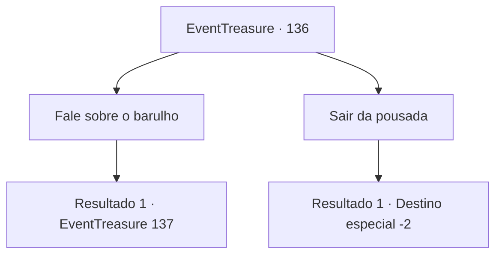

# Eventos de tesouro · 136

[Índice da tabela](index.md) · [Índice geral](../index.md)

ID: `pt:EventTreasure:136` · Fonte: `EventTreasure4` · Versão: 1.2.47.

Mapeamento estático dos arquivos; a disponibilidade e a execução dependem do estado da run.

## Texto do evento

Enquanto dorme em uma pousada, você acorda com um barulho estranho. Soa como se alguém estivesse comendo. Acontecendo intermitentemente, perturba o seu sono a noite toda. Insuportável, você procura no quarto, mas falha em achar a fonte do barulho.

 Na manhã seguinte, você desce para o térreo com olhos aprofundados. A dona da pousada olha para você e pergunta se você está bem.

## Dados de entrada

```json
{
  "id": 136,
  "grade": 1,
  "place": "",
  "required": "5_346_0"
}
```

## Mapa das escolhas



## Escolhas e resultados

### Escolha 1

Fale sobre o barulho

Requisitos e outros campos da escolha:

```json
{
  "required": ""
}
```

#### Resultado 1.1

Você conta ao estalajadeiro sobre o barulho da noite passada. Ele coça a nuca e suspira. 

 "*suspiro* Você também ouviu isso? Estou ouvindo isso há dias, mas não faço ideia do que seja."

 O estalajadeiro pede desculpas e acrescenta que vai melhorar em breve, pois ele denunciou aos guardas.

Continuação registrada: [Evento 137](0137.md) na mesma tabela.

```json
{
  "required": "",
  "chance": "1",
  "nextEvent": 137,
  "type": 2,
  "reward": ""
}
```

### Escolha 2

Sair da pousada

Requisitos e outros campos da escolha:

```json
{
  "required": ""
}
```

#### Resultado 2.1

Você não mostra nenhuma reação e sai da pousada.

Continuação registrada: [Destino especial `-2`](../destinos-especiais.md).

```json
{
  "required": "",
  "chance": "1",
  "nextEvent": -2,
  "type": 2,
  "reward": "5_346_10"
}
```

## Referências que chegam a este evento

Nenhum `nextEvent` positivo da mesma tabela aponta para este nó. Isso não prova que seja inacessível: sorteio e estado de história podem selecioná-lo.

