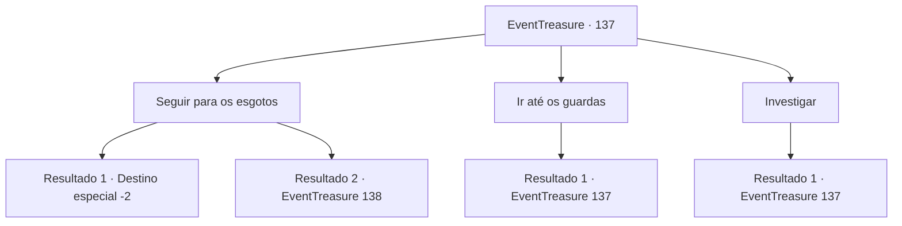

# Eventos de tesouro · 137

[Índice da tabela](index.md) · [Índice geral](../index.md)

ID: `pt:EventTreasure:137` · Fonte: `EventTreasure4` · Versão: 1.2.47.

Mapeamento estático dos arquivos; a disponibilidade e a execução dependem do estado da run.

## Texto do evento

*Sem texto no arquivo.*

## Dados de entrada

```json
{
  "id": 137,
  "grade": 1,
  "place": "",
  "required": ""
}
```

## Mapa das escolhas



## Escolhas e resultados

### Escolha 1

Seguir para os esgotos

Requisitos e outros campos da escolha:

```json
{
  "required": "5_347_1"
}
```

#### Resultado 1.1

Você entra no esgoto subterrâneo. No entanto, você não pode ver nada, pois é escuro como breu por dentro, mesmo em plena luz do dia. Relutantemente, você sai do esgoto.

Continuação registrada: [Destino especial `-2`](../destinos-especiais.md).

```json
{
  "required": "24_3_1|21_0_1",
  "chance": "1",
  "nextEvent": -2,
  "type": 2,
  "reward": "5_347_2|5_346_10"
}
```

#### Resultado 1.2

Você entra no esgoto subterrâneo. É escuro como breu por dentro, mesmo em plena luz do dia, mas você pode ver à frente com a luz que acendeu. Além disso, o caminho à sua frente é principalmente reto, não há necessidade de encontrar o caminho. Ao caminhar pelo esgoto, você percebe algo estranho de repente. O lugar é muito limpo para um esgoto. Até o esgoto que flui no canal parece claro.

 '*golpe* *estômago roncando* *roncando*'

 Então, você ouve um barulho estranho do canto.

Continuação registrada: [Evento 138](0138.md) na mesma tabela.

```json
{
  "required": "-1|23_3_1|20_0_1",
  "chance": "1",
  "nextEvent": 138,
  "type": 2,
  "reward": ""
}
```

### Escolha 2

Ir até os guardas

Requisitos e outros campos da escolha:

```json
{
  "required": "5_346_0"
}
```

#### Resultado 2.1

Você visita o quartel da cidade e fala sobre o barulho da pousada. Um velho oficial responde com um bocejo vagaroso. 

 "Oh, essa história de novo? Recebi alguns pedidos, então fui lá... mas não teve nada de estranho."

 Ele balança a cabeça, dizendo que deve ser algo como um rato. Enquanto você continua olhando para ele, ele puxa uma lanterna de debaixo da mesa, com uma expressão envergonhada. 

 "De qualquer forma, não posso investigar mais. Estamos ocupados, você sabe. Se você precisa de uma investigação, faça você mesmo. Vou te emprestar uma lanterna."

 Ele passa a lanterna para você casualmente e acena com a mão. É claramente uma ordem para sair, então você sai.

Continuação registrada: [Evento 137](0137.md) na mesma tabela.

```json
{
  "required": "",
  "chance": "1",
  "nextEvent": 137,
  "type": 2,
  "reward": "5_346_1|3_42_1"
}
```

### Escolha 3

Investigar

Requisitos e outros campos da escolha:

```json
{
  "required": "5_347_0"
}
```

#### Resultado 3.1

Você anda pela cidade e pergunta sobre o barulho da pousada. Você aprende algo especial, que o barulho estranho não é ouvido apenas na pousada. Uma moça conta a história. 

 "Acho que ouvi aquele som perto dos esgotos. Pode ter algo a ver com isso."

 Você parte com ela e sai do lugar.

Continuação registrada: [Evento 137](0137.md) na mesma tabela.

```json
{
  "required": "",
  "chance": "1",
  "nextEvent": 137,
  "type": 2,
  "reward": "5_347_1"
}
```

## Referências que chegam a este evento

- [Evento 136 · escolha 1 · resultado 1](0136.md#escolha-1)
- [Evento 137 · escolha 2 · resultado 1](0137.md#escolha-2)
- [Evento 137 · escolha 3 · resultado 1](0137.md#escolha-3)
