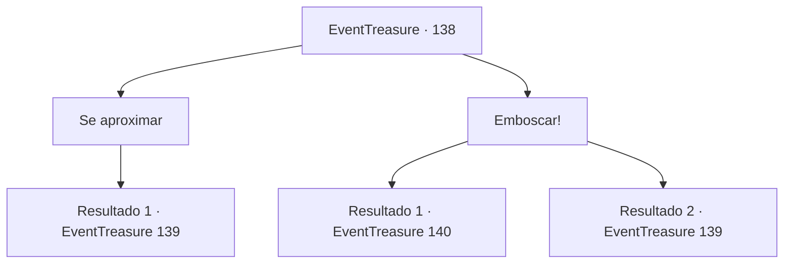

# Eventos de tesouro · 138

[Índice da tabela](index.md) · [Índice geral](../index.md)

ID: `pt:EventTreasure:138` · Fonte: `EventTreasure4` · Versão: 1.2.47.

Mapeamento estático dos arquivos; a disponibilidade e a execução dependem do estado da run.

## Texto do evento

*Sem texto no arquivo.*

## Dados de entrada

```json
{
  "id": 138,
  "grade": 1,
  "place": "",
  "required": ""
}
```

## Mapa das escolhas



## Escolhas e resultados

### Escolha 1

Se aproximar

Requisitos e outros campos da escolha:

```json
{
  "required": ""
}
```

#### Resultado 1.1

Ao virar a esquina lenta e silenciosamente, você vê algo como uma poça de uma gosma preta. A coisa viscosa preta se contorce e depois ataca você em um instante.

Continuação registrada: [Evento 139](0139.md) na mesma tabela.

```json
{
  "required": "",
  "chance": "1",
  "nextEvent": 139,
  "type": 2,
  "reward": "6_0_142",
  "place": 7
}
```

### Escolha 2

Emboscar!

Requisitos e outros campos da escolha:

```json
{
  "required": ""
}
```

#### Resultado 2.1

Você imediatamente entra e vira a esquina. Você aponta sua arma para algo preto, escondido na escuridão. Ele estremece de surpresa, depois flutua ao longo do canal. É um pedaço de lodo preto, um monstro chamado 'pudim negro'. Uma pudim negro engole tudo o que encontra, então isso explica por que o esgoto é tão limpo. Claro, é estranho vê-lo no subsolo de uma cidade, em vez de uma masmorra.

Continuação registrada: [Evento 140](0140.md) na mesma tabela.

```json
{
  "required": "",
  "chance": "1|0_6_1",
  "nextEvent": 140,
  "type": 0,
  "reward": "0_2_1"
}
```

#### Resultado 2.2

Você imediatamente entra e vira a esquina. Você aponta sua arma para algo preto, escondido na escuridão. Ele estremece de surpresa, então corre para você.

Continuação registrada: [Evento 139](0139.md) na mesma tabela.

```json
{
  "required": "",
  "chance": "8",
  "nextEvent": 139,
  "type": 1,
  "reward": "6_0_142",
  "place": 7
}
```

## Referências que chegam a este evento

- [Evento 137 · escolha 1 · resultado 2](0137.md#escolha-1)
