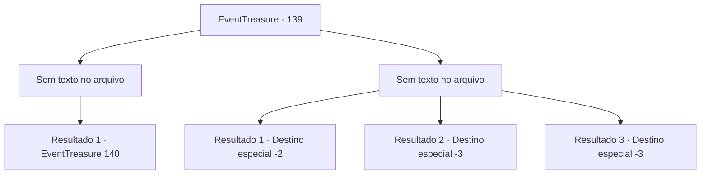

# Eventos de tesouro · 139

[Índice da tabela](index.md) · [Índice geral](../index.md)

ID: `pt:EventTreasure:139` · Fonte: `EventTreasure4` · Versão: 1.2.47.

Mapeamento estático dos arquivos; a disponibilidade e a execução dependem do estado da run.

## Texto do evento

*Sem texto no arquivo.*

## Dados de entrada

```json
{
  "id": 139,
  "grade": 1,
  "place": "",
  "required": ""
}
```

## Mapa das escolhas



## Escolhas e resultados

### Escolha 1

*Sem texto no arquivo; o papel dessa opção depende da interface do jogo.*

Requisitos e outros campos da escolha:

```json
{
  "required": ""
}
```

#### Resultado 1.1

À medida que você destrói seu núcleo, ele flutua ao longo do canal. Você recupera o fôlego, percebendo que era uma 'pudim negro' que se afastou. Uma pudim negro engole tudo o que encontra, então isso explica por que o esgoto é tão limpo. Claro, é estranho vê-lo no subsolo de uma cidade, em vez de uma masmorra.

Continuação registrada: [Evento 140](0140.md) na mesma tabela.

```json
{
  "required": "",
  "chance": "1",
  "nextEvent": 140,
  "type": 2,
  "reward": ""
}
```

### Escolha 2

*Sem texto no arquivo; o papel dessa opção depende da interface do jogo.*

Requisitos e outros campos da escolha:

```json
{
  "required": ""
}
```

#### Resultado 2.1

A gosma corrosiva dele queima sua carne. Você se assusta com a dor vertiginosa e foge do pudim negro.

Continuação registrada: [Destino especial `-2`](../destinos-especiais.md).

```json
{
  "required": "1_0_2|1_1_2",
  "chance": "1",
  "nextEvent": -2,
  "type": 2,
  "reward": "0_0_-1|0_1_-1|5_346_10"
}
```

#### Resultado 2.2

Ele envolve todo o seu corpo e começa a digerir você. Você luta dentro do monstro negro, mas em vão. Você encontra a morte dentro do 'pudim negro'.

Continuação registrada: [Destino especial `-3`](../destinos-especiais.md).

```json
{
  "required": "2_0_2",
  "chance": "1",
  "nextEvent": -3,
  "type": 2,
  "reward": "0_0_-1|0_1_-1"
}
```

#### Resultado 2.3

Ele envolve todo o seu corpo e começa a digerir você. Você luta dentro do monstro negro, mas em vão. Você encontra a morte dentro do 'pudim negro'.

Continuação registrada: [Destino especial `-3`](../destinos-especiais.md).

```json
{
  "required": "2_1_2",
  "chance": "1",
  "nextEvent": -3,
  "type": 2,
  "reward": "0_0_-1|0_1_-1"
}
```

## Referências que chegam a este evento

- [Evento 138 · escolha 1 · resultado 1](0138.md#escolha-1)
- [Evento 138 · escolha 2 · resultado 2](0138.md#escolha-2)
