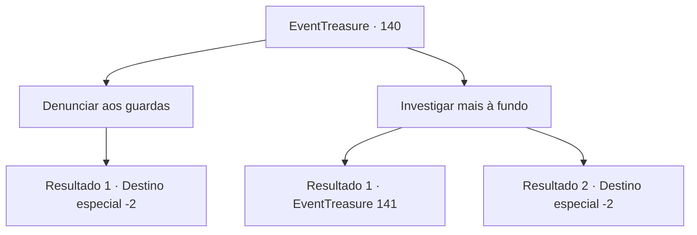

# Eventos de tesouro · 140

[Índice da tabela](index.md) · [Índice geral](../index.md)

ID: `pt:EventTreasure:140` · Fonte: `EventTreasure4` · Versão: 1.2.47.

Mapeamento estático dos arquivos; a disponibilidade e a execução dependem do estado da run.

## Texto do evento

*Sem texto no arquivo.*

## Dados de entrada

```json
{
  "id": 140,
  "grade": 1,
  "place": "",
  "required": ""
}
```

## Mapa das escolhas



## Escolhas e resultados

### Escolha 1

Denunciar aos guardas

Requisitos e outros campos da escolha:

```json
{
  "required": ""
}
```

#### Resultado 1.1

Você volta ao quartel e informa que encontrou uma pudim negro. No entanto, o velho oficial permanece indiferente como sempre. 

 "pudim negro? Bem, acho que é o suficiente se você conseguiu matá-lo. Claro, pegue sua recompensa."

 Ele lhe entrega um bolso de ouro e acena com a mão. É um gesto para não incomodá-lo mais, então você pega o ouro e sai silenciosamente.

Continuação registrada: [Destino especial `-2`](../destinos-especiais.md).

```json
{
  "required": "",
  "chance": "1",
  "nextEvent": -2,
  "type": 2,
  "reward": "0_4_60|5_346_10"
}
```

### Escolha 2

Investigar mais à fundo

Requisitos e outros campos da escolha:

```json
{
  "required": ""
}
```

#### Resultado 2.1

Você anda pelos esgotos e investiga mais. Você vê uma mancha de sangue e segue, para encontrar um círculo mágico gravado com sangue. A pudim negro deve ter sido convocada com ele. O círculo mágico está localizado no final dos esgotos. Além dele, você vê um caminho que leva a uma floresta escura.

Continuação registrada: [Evento 141](0141.md) na mesma tabela.

```json
{
  "required": "",
  "chance": "1|0_7_1",
  "nextEvent": 141,
  "type": 0,
  "reward": "0_2_1"
}
```

#### Resultado 2.2

Você anda pelos esgotos e investiga mais. No entanto, não importa o quanto você procure, não há vestígios de nada estranho. Relutantemente, você desiste da investigação e sai dos esgotos.

Continuação registrada: [Destino especial `-2`](../destinos-especiais.md).

```json
{
  "required": "",
  "chance": "13",
  "nextEvent": -2,
  "type": 1,
  "reward": "5_346_10"
}
```

## Referências que chegam a este evento

- [Evento 138 · escolha 2 · resultado 1](0138.md#escolha-2)
- [Evento 139 · escolha 1 · resultado 1](0139.md#escolha-1)
