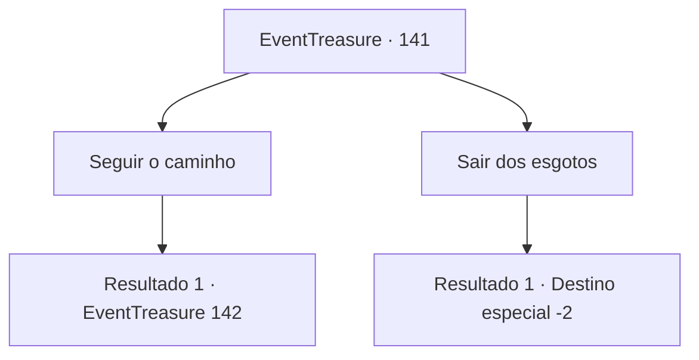

# Eventos de tesouro · 141

[Índice da tabela](index.md) · [Índice geral](../index.md)

ID: `pt:EventTreasure:141` · Fonte: `EventTreasure4` · Versão: 1.2.47.

Mapeamento estático dos arquivos; a disponibilidade e a execução dependem do estado da run.

## Texto do evento

*Sem texto no arquivo.*

## Dados de entrada

```json
{
  "id": 141,
  "grade": 1,
  "place": "",
  "required": ""
}
```

## Mapa das escolhas



## Escolhas e resultados

### Escolha 1

Seguir o caminho

Requisitos e outros campos da escolha:

```json
{
  "required": ""
}
```

#### Resultado 1.1

Você sai dos esgotos e entra na floresta escura. À medida que você vai mais fundo, o vento sombrio se torna mais forte. O sol se põe em um instante e a escuridão cai. Enquanto caminha com cuidado, você avista três velhas conversando, sob o luar. Você chega um pouco mais perto e percebe que eles não são humanos comuns, mas uma espécie de monstro chamado 'bruxa'. Elas se parecem à primeira vista, mas todos os três são diferentes. |drawing_Hags| A primeira é uma 'bruxa da noite' com pele roxa, dentes afiados e um chifre. Está usando um cinto adornado com uma caveira. A segunda é uma 'bruxa do mar', com pele azul, dedos palmados e cabelos como algas marinhas. A última é uma 'bruxa verde' com pele verde, braços deformados e costas corcundas.

Continuação registrada: [Evento 142](0142.md) na mesma tabela.

```json
{
  "required": "",
  "chance": "1",
  "nextEvent": 142,
  "type": 2,
  "reward": ""
}
```

### Escolha 2

Sair dos esgotos

Requisitos e outros campos da escolha:

```json
{
  "required": ""
}
```

#### Resultado 2.1

Você sai dos esgotos com uma sensação sinistra e vai para outro lugar.

Continuação registrada: [Destino especial `-2`](../destinos-especiais.md).

```json
{
  "required": "",
  "chance": "1",
  "nextEvent": -2,
  "type": 2,
  "reward": "5_346_10"
}
```

## Referências que chegam a este evento

- [Evento 140 · escolha 2 · resultado 1](0140.md#escolha-2)
