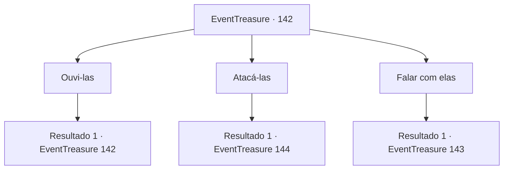

# Eventos de tesouro · 142

[Índice da tabela](index.md) · [Índice geral](../index.md)

ID: `pt:EventTreasure:142` · Fonte: `EventTreasure4` · Versão: 1.2.47.

Mapeamento estático dos arquivos; a disponibilidade e a execução dependem do estado da run.

## Texto do evento

*Sem texto no arquivo.*

## Dados de entrada

```json
{
  "id": 142,
  "grade": 1,
  "place": "",
  "required": ""
}
```

## Mapa das escolhas



## Escolhas e resultados

### Escolha 1

Ouvi-las

Requisitos e outros campos da escolha:

```json
{
  "required": "5_348_0"
}
```

#### Resultado 1.1

A bruxa da noite, usando um cinto de caveira, fala. 

 "A propósito, eu me pergunto se o nosso lindo pudim negro está crescendo bem? Ele Ele. Deve crescer rapidamente e devorar toda a vila."

 A bruxa verde ao lado dela reclama. 

 "VAI DEMORAR PARA SEMPRE! Vamos envenenar o poço agora. Será muito mais rápido do que aquele plano estúpido."

 A bruxa do mar, à beira da água, intervém entre as duas bruxas. 

 "Não seja impaciente. Podemos sempre envenenar o poço, se não funcionar com a pudim! Kehehe."


Continuação registrada: [Evento 142](0142.md) na mesma tabela.

```json
{
  "required": "",
  "chance": "1",
  "nextEvent": 142,
  "type": 2,
  "reward": "5_348_1"
}
```

### Escolha 2

Atacá-las

Requisitos e outros campos da escolha:

```json
{
  "required": ""
}
```

#### Resultado 2.1

Você pega sua arma e pula nas bruxas. Elas ficam surpresos com sua investida repentina, mas rapidamente trabalham juntos e contra-atacam. Logo, maldições sinistras voam para você de todos os lugares.

Continuação registrada: [Evento 144](0144.md) na mesma tabela.

```json
{
  "required": "",
  "chance": "1",
  "nextEvent": 144,
  "type": 2,
  "reward": "6_0_143",
  "place": 1
}
```

### Escolha 3

Falar com elas

Requisitos e outros campos da escolha:

```json
{
  "required": ""
}
```

#### Resultado 3.1

Você se aproxima das bruxas e fala com elas. Elas o observam com cautela, sorrindo maldosamente. A bruxa da noite fala. 

 "Ooh, um humano em um lugar como este? Bom. Eu vou ter a cabeça daquele bastardo!"

 A bruxa verde grita em resposta. 

 "NUNCA! Deve ser eu quem vai matá-lo! Eu também quero me divertir!"

 A bruxa do mar sai da água e resolve suas diferenças. 

 "Green o mata, e a noite leva a cabeça. Eu estou bem se eu apenas ver o sangue dele. Kehehe!"


Continuação registrada: [Evento 143](0143.md) na mesma tabela.

```json
{
  "required": "",
  "chance": "1",
  "nextEvent": 143,
  "type": 2,
  "reward": ""
}
```

## Referências que chegam a este evento

- [Evento 141 · escolha 1 · resultado 1](0141.md#escolha-1)
- [Evento 142 · escolha 1 · resultado 1](0142.md#escolha-1)
