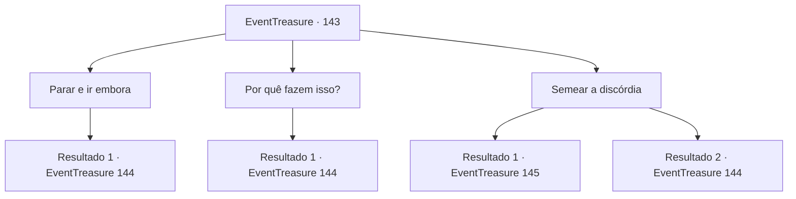

# Eventos de tesouro · 143

[Índice da tabela](index.md) · [Índice geral](../index.md)

ID: `pt:EventTreasure:143` · Fonte: `EventTreasure4` · Versão: 1.2.47.

Mapeamento estático dos arquivos; a disponibilidade e a execução dependem do estado da run.

## Texto do evento

*Sem texto no arquivo.*

## Dados de entrada

```json
{
  "id": 143,
  "grade": 1,
  "place": "",
  "required": ""
}
```

## Mapa das escolhas



## Escolhas e resultados

### Escolha 1

Parar e ir embora

Requisitos e outros campos da escolha:

```json
{
  "required": ""
}
```

#### Resultado 1.1

Você avisa as bruxas para desistirem da trama maligna e irem embora. Eles zombam de você e começam a conjurar magia negra. Logo, maldições sinistras voam para você de todos os lugares.

Continuação registrada: [Evento 144](0144.md) na mesma tabela.

```json
{
  "required": "",
  "chance": "1",
  "nextEvent": 144,
  "type": 2,
  "reward": "6_0_143",
  "place": 1
}
```

### Escolha 2

Por quê fazem isso?

Requisitos e outros campos da escolha:

```json
{
  "required": ""
}
```

#### Resultado 2.1

Você pergunta por que eles fazem isso. As bruxas zombam de você e dão diferentes razões. A bruxa da noite fala. 

 "Adoramos ver humanos sofrendo!"

 A bruxa verde conta enquanto baba. 

 "NUNCA! É só... só por diversão. *suspiro*"

 A bruxa do mar responde como um árbitro. 

 "Nós amamos isso, e também é divertido. Esses motivos não são suficientes? Kehehe."

 Logo depois, as Bruxas correm em sua direção e lançam maldições sinistras.

Continuação registrada: [Evento 144](0144.md) na mesma tabela.

```json
{
  "required": "",
  "chance": "1",
  "nextEvent": 144,
  "type": 2,
  "reward": "6_0_143",
  "place": 1
}
```

### Escolha 3

Semear a discórdia

Requisitos e outros campos da escolha:

```json
{
  "required": "1_14_11"
}
```

#### Resultado 3.1

Você percebe que a bruxa do mar sempre faz a mediação entre as outras. Você pretende botar lenha na fogueira entre elas e perguntar à bruxa do mar, se ela é a mais poderosa entre elas. As outras duas bruxas franzem a sobrancelha. 

 "O que? Ela, a mais poderosa? O que há de errado com esse idiota?"

 A bruxa verde entra na conversa. 

 "PIOR! Ela é a mais fraca de nós, e eu sou a mais poderosa!"

 A bruxa do mar furiosa. 

 "Quem você chamou de mais fraca? Malditas vadias! Você vai morrer!!"

 Você não precisa dar um passo à frente. As bruxas lutam entre si e terminam umas com as outras. Após a luta, uma jóia negra rola das bruxas.

Continuação registrada: [Evento 145](0145.md) na mesma tabela.

```json
{
  "required": "",
  "chance": "1|0_14_1",
  "nextEvent": 145,
  "type": 0,
  "reward": "0_2_1|3_244_1"
}
```

#### Resultado 3.2

Você percebe que a bruxa do mar sempre faz a mediação entre as outras. Você pretende botar lenha na fogueira entre elas e perguntar à bruxa do mar se ela é a mais poderosa entre elas. As três bruxas riem da pergunta. 

 "Haha! Olhe para ele! Que truque estúpido!"

 A bruxa verde entra na conversa. 

 "Ele se atreve a nos fazer lutar uma contra o outra? SEM CHANCE!"

 A bruxa do mar fala ao sair da água. 

 "Chega de conversa, agora. Vamos matá-lo."

 Com as palavras da bruxa do mar, as bruxas lançam maldições sinistras em você.

Continuação registrada: [Evento 144](0144.md) na mesma tabela.

```json
{
  "required": "",
  "chance": "14",
  "nextEvent": 144,
  "type": 1,
  "reward": "6_0_143",
  "place": 1
}
```

## Referências que chegam a este evento

- [Evento 142 · escolha 3 · resultado 1](0142.md#escolha-3)
