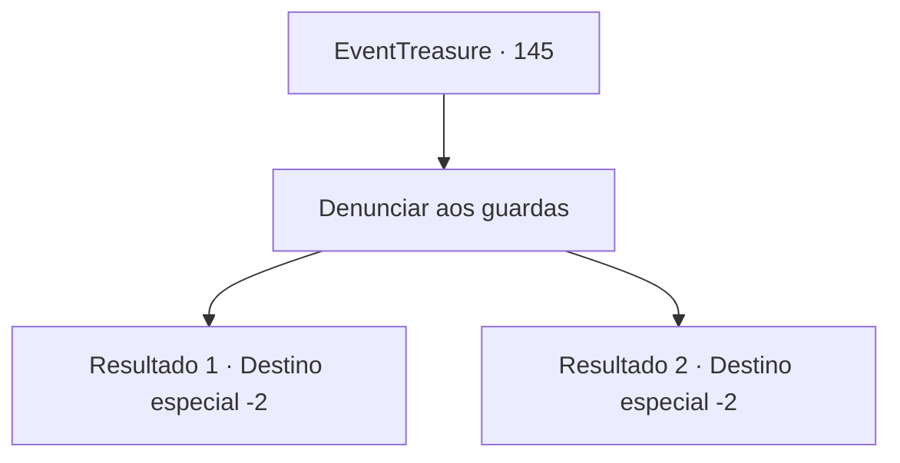

# Eventos de tesouro · 145

[Índice da tabela](index.md) · [Índice geral](../index.md)

ID: `pt:EventTreasure:145` · Fonte: `EventTreasure4` · Versão: 1.2.47.

Mapeamento estático dos arquivos; a disponibilidade e a execução dependem do estado da run.

## Texto do evento

*Sem texto no arquivo.*

## Dados de entrada

```json
{
  "id": 145,
  "grade": 1,
  "place": "",
  "required": ""
}
```

## Mapa das escolhas



## Escolhas e resultados

### Escolha 1

Denunciar aos guardas

Requisitos e outros campos da escolha:

```json
{
  "required": ""
}
```

#### Resultado 1.1

Você pega a jóia negra e volta para o quartel. Você relata que encontrou um pudim preto e três bruxas, e se livrou deles. O velho oficial olha para você da cabeça aos pés e fala. 

 "Existiam essas coisas em nossa cidade ..?"

 Então ele ordena que seus homens investiguem os esgotos. 

 "Por favor, espere aqui. Eu o recompensarei assim que for confirmado que você matou esses monstros."

 Pouco depois, um jovem oficial trouxe o corpo da bruxa da noite e um pouco de lodo da pudim negro. Só então o velho oficial admitiu que você está dizendo a verdade. 

 "Então era verdade. Você fez o nosso trabalho por nós. Obrigado..."

 O oficial agradece e lhe entrega um saco de ouro.

Continuação registrada: [Destino especial `-2`](../destinos-especiais.md).

```json
{
  "required": "8_244_1",
  "chance": "1",
  "nextEvent": -2,
  "type": 2,
  "reward": "0_4_80|5_346_10"
}
```

#### Resultado 1.2

Você volta ao quartel e informa que encontrou um pudim negro e três bruxas. O velho oficial se levanta de seu assento, erguendo as sobrancelhas. 

 "pudim negro? Bruxas? Hmm... eu vou ter que relatar isso ao senhorio imediatamente. Obrigado por me avisar."

 Ele lhe entrega um saco de ouro e se dirige ao proprietário com seus homens.

Continuação registrada: [Destino especial `-2`](../destinos-especiais.md).

```json
{
  "required": "10_244_1",
  "chance": "1",
  "nextEvent": -2,
  "type": 2,
  "reward": "0_4_50|5_346_10"
}
```

## Referências que chegam a este evento

- [Evento 143 · escolha 3 · resultado 1](0143.md#escolha-3)
- [Evento 144 · escolha 1 · resultado 1](0144.md#escolha-1)
- [Evento 144 · escolha 2 · resultado 1](0144.md#escolha-2)
