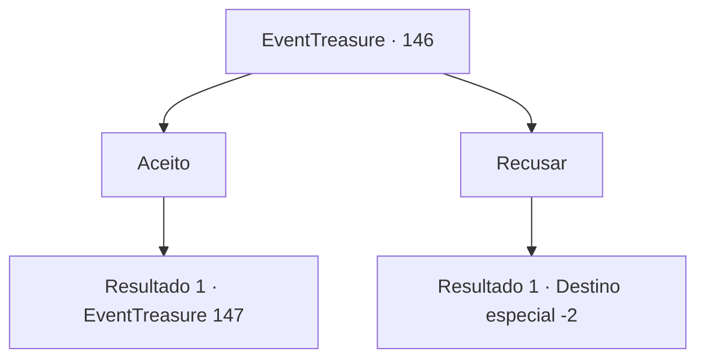

# Eventos de tesouro · 146

[Índice da tabela](index.md) · [Índice geral](../index.md)

ID: `pt:EventTreasure:146` · Fonte: `EventTreasure4` · Versão: 1.2.47.

Mapeamento estático dos arquivos; a disponibilidade e a execução dependem do estado da run.

## Texto do evento

Você atravessou o deserto rochoso escaldante, onde um vento quente e seco soprava implacávelmente, e finalmente então você chegou a Lenozia. Lenozia era uma cidade construída em torno de um oásis, um local constantemente visitado por viajantes. Na frente dos portões da cidade, guardas de segurança estavam realizando inspeções em pessoas. 

 "Por favor, aguardem pela inspeção"

 Finalmente, chegou a sua vez e os guardas de segurança se aproximaram, fazendo várias perguntas sobre você. A maioria das perguntas estava relacionada ao senhor de Lenozia. Além disso, eles também perguntaram sobre suas experiências passadas. Após vários minutos, os guardas de segurança informaram que a inspeção havia terminado. 

 "Agora você pode prosseguir. Mas, a propósito, aventureiro, você consideraria trabalhar para o senhor feudal?"

  perguntou um dos guardas, exigindo uma resposta mais detalhada se você estivesse interessado.

## Dados de entrada

```json
{
  "id": 146,
  "grade": 1,
  "place": "",
  "required": "5_500_0|1_2_35|1_3_0"
}
```

## Mapa das escolhas



## Escolhas e resultados

### Escolha 1

Aceito

Requisitos e outros campos da escolha:

```json
{
  "required": ""
}
```

#### Resultado 1.1

Você aceita a oferta dele com um aceno de cabeça. Então o segurança o leva para algum lugar. Depois de um tempo, você chega a um palácio luxuoso localizado dentro da cidade. O prédio é banhado a ouro, cheio de móveis luxuosos e luxos. Você segue o segurança pelo longo corredor. No final, há um escritório espaçoso. O segurança abre a porta e se curva para o dono da sala. 

 "Meu senhor, trago uma nova escolta. Este é um aventureiro conhecido cujo histórico parece claro."

 Então um homem chamado senhor se levanta da cadeira e lhe dá as boas-vindas. 

 "Oh! Eu estava esperando!"


Continuação registrada: [Evento 147](0147.md) na mesma tabela.

```json
{
  "required": "",
  "chance": "1",
  "nextEvent": 147,
  "type": 2,
  "reward": ""
}
```

### Escolha 2

Recusar

Requisitos e outros campos da escolha:

```json
{
  "required": ""
}
```

#### Resultado 2.1

Você recusa a oferta dele e vai para Lenozoa. E refresca o suor no oásis.

Continuação registrada: [Destino especial `-2`](../destinos-especiais.md).

```json
{
  "required": "",
  "chance": "1",
  "nextEvent": -2,
  "type": 2,
  "reward": "5_500_10"
}
```

## Referências que chegam a este evento

Nenhum `nextEvent` positivo da mesma tabela aponta para este nó. Isso não prova que seja inacessível: sorteio e estado de história podem selecioná-lo.

