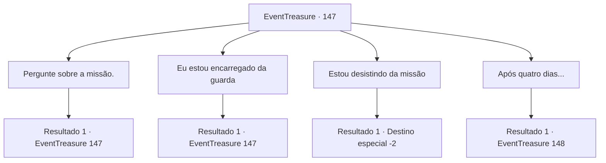

# Eventos de tesouro · 147

[Índice da tabela](index.md) · [Índice geral](../index.md)

ID: `pt:EventTreasure:147` · Fonte: `EventTreasure4` · Versão: 1.2.47.

Mapeamento estático dos arquivos; a disponibilidade e a execução dependem do estado da run.

## Texto do evento

*Sem texto no arquivo.*

## Dados de entrada

```json
{
  "id": 147,
  "grade": 1,
  "place": "",
  "required": ""
}
```

## Mapa das escolhas



## Escolhas e resultados

### Escolha 1

Pergunte sobre a missão.

Requisitos e outros campos da escolha:

```json
{
  "required": "5_500_0"
}
```

#### Resultado 1.1

Você expressou interesse em uma missão para o Lorde. O Lorde se apresentou como Conde Copenny e desabafou sobre sua situação. 

 "Há alguns dias, recebi uma carta de ameaça. Disseram que me matariam durante a abençoada Noite das Areias, quando a tempestade de areia sopra com mais intensidade."

 Ele investigou quem enviou a carta, mas não conseguiu descobrir. O Conde Copenny tremia enquanto continuava a falar. 

 "A Noite das Areias está a quatro dias de distância. Se você me proteger até lá, darei a você 300 moedas de ouro. Como adiantamento, darei 50 moedas de ouro. O que me diz?"

 Seu olhar ansioso se voltou para você.

Continuação registrada: [Evento 147](0147.md) na mesma tabela.

```json
{
  "required": "",
  "chance": "1",
  "nextEvent": 147,
  "type": 2,
  "reward": "5_500_1"
}
```

### Escolha 2

Eu estou encarregado da guarda

Requisitos e outros campos da escolha:

```json
{
  "required": "5_500_1"
}
```

#### Resultado 2.1

Você aceitou a missão de escoltar o Conde Copenny depois de receber o adiantamento.

 Desde o dia em que aceitou a missão, você acompanhou a programação do Conde Copenny. Durante esse tempo, você descobriu algumas verdades, uma delas sendo que o Conde Copenny mantinha sua riqueza de maneira ilegítima. 

 "Isso é injusto! Meu Senhor, por favor!"

 A habilidade especial do Conde Copenny era atribuir crimes a cidadãos inocentes. Aqueles que ele capturava se tornavam todos criminosos, e o Conde Copenny acumulava suas propriedades roubadas para aumentar sua riqueza. Além disso, ele frequentemente inventava desculpas para cobrar impostos extras e enviava soldados para esmagar aqueles que se rebelavam.

Continuação registrada: [Evento 147](0147.md) na mesma tabela.

```json
{
  "required": "",
  "chance": "1",
  "nextEvent": 147,
  "type": 2,
  "reward": "0_4_50|5_500_2"
}
```

### Escolha 3

Estou desistindo da missão

Requisitos e outros campos da escolha:

```json
{
  "required": "5_500_1"
}
```

#### Resultado 3.1

Você gentilmente recusou a missão de escolta e deixou o escritório. O suspiro do Conde Copenny ecoou até fora da sala

Continuação registrada: [Destino especial `-2`](../destinos-especiais.md).

```json
{
  "required": "",
  "chance": "1",
  "nextEvent": -2,
  "type": 2,
  "reward": "5_500_10"
}
```

### Escolha 4

Após quatro dias...

Requisitos e outros campos da escolha:

```json
{
  "required": "5_500_2"
}
```

#### Resultado 4.1

No quarto dia desde que você recebeu a missão de escoltar o Conde Copenny, você estava de guarda em frente ao seu quarto durante a noite. Ao contrário do que estava escrito na carta de ameaça, a noite passou tranquilamente.

 'Toc! Toc!'

 Conforme a madrugada se aproximava, você ouviu um som suspeito vindo do outro lado do corredor. Era na direção do salão de festas.

Continuação registrada: [Evento 148](0148.md) na mesma tabela.

```json
{
  "required": "",
  "chance": "1",
  "nextEvent": 148,
  "type": 2,
  "reward": ""
}
```

## Referências que chegam a este evento

- [Evento 146 · escolha 1 · resultado 1](0146.md#escolha-1)
- [Evento 147 · escolha 1 · resultado 1](0147.md#escolha-1)
- [Evento 147 · escolha 2 · resultado 1](0147.md#escolha-2)
