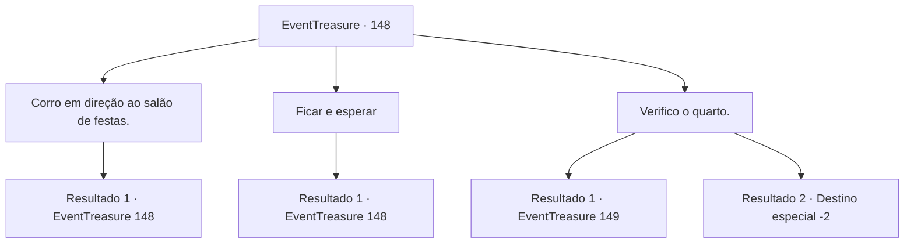

# Eventos de tesouro · 148

[Índice da tabela](index.md) · [Índice geral](../index.md)

ID: `pt:EventTreasure:148` · Fonte: `EventTreasure4` · Versão: 1.2.47.

Mapeamento estático dos arquivos; a disponibilidade e a execução dependem do estado da run.

## Texto do evento

*Sem texto no arquivo.*

## Dados de entrada

```json
{
  "id": 148,
  "grade": 1,
  "place": "",
  "required": ""
}
```

## Mapa das escolhas



## Escolhas e resultados

### Escolha 1

Corro em direção ao salão de festas.

Requisitos e outros campos da escolha:

```json
{
  "required": "5_501_0"
}
```

#### Resultado 1.1

Você correu rapidamente em direção ao salão de festas. Lá, havia empregadas ocupadas limpando os cacos de louça quebrada. A empregada mais jovem parecia estranha e falou como se não fosse nada. 

 "Não se preocupe, não é grande coisa. Apenas um prato quebrado. Mas, por que isso está aqui? Eu o coloquei no armário."

 De repente, uma sensação sombria percorreu sua espinha, deixando-o arrepiado.

Continuação registrada: [Evento 148](0148.md) na mesma tabela.

```json
{
  "required": "",
  "chance": "1",
  "nextEvent": 148,
  "type": 2,
  "reward": "5_501_1"
}
```

### Escolha 2

Ficar e esperar

Requisitos e outros campos da escolha:

```json
{
  "required": "5_501_0"
}
```

#### Resultado 2.1

Você permaneceu de guarda em frente ao quarto, onde ouviu o som suspeito. No entanto, o assassino não se revelou enquanto o céu gradualmente clareava até o amanhecer. Uma sensação sombria percorreu sua espinha, deixando-o arrepiado mais uma vez.

Continuação registrada: [Evento 148](0148.md) na mesma tabela.

```json
{
  "required": "",
  "chance": "1",
  "nextEvent": 148,
  "type": 2,
  "reward": "5_501_1"
}
```

### Escolha 3

Verifico o quarto.

Requisitos e outros campos da escolha:

```json
{
  "required": ""
}
```

#### Resultado 3.1

Você verificou apressadamente o quarto do Conde Copenny. Ao abrir a porta, você viu um assassino segurando uma adaga afiada enquanto esmagava o Conde Copenny. A aparência característica da lâmina afiada indicava que ele era um 'assassino de aluguel'. O Conde Copenny olhou para você com uma expressão de pavor, incapaz de falar devido ao choque. Os olhos do assassino também se voltaram para você. 

 "...Esse homem está drenando o sangue de nossos compatriotas. Você também deve saber, não é?"

 Ele ordenou friamente que você partisse como se não tivesse te visto antes. O Conde Copenny olhou para você desesperadamente, balançando a cabeça. Gotas de suor escorriam pelo seu rosto.

Continuação registrada: [Evento 149](0149.md) na mesma tabela.

```json
{
  "required": "5_501_0",
  "chance": "1",
  "nextEvent": 149,
  "type": 2,
  "reward": ""
}
```

#### Resultado 3.2

Você verificou apressadamente o quarto do Conde Copenny. Ao abrir a porta, encontrou o Conde Copenny caído no chão, sangrando. Seu corpo estava marcado por dezenas de perfurações. As feridas pareciam envenenadas, pois estavam necrosadas e havia espuma seca ao redor de sua boca. Você olhou ao redor, mas não encontrou nenhum vestígio do assassino em lugar algum. 

 Após vários dias de investigação em Lenoire, você finalmente conseguiu provar sua inocência. O antigo mordomo do Conde se aproximou de você e disse: 

 "Bem... Embora seja um pouco difícil dizer isso, podemos considerar isso como um caso de karma. O Conde acumulou muitos inimigos ao longo dos anos. Você fez um bom trabalho. Agora você pode partir."

 Após se despedir do mordomo do Conde, você deixou Lenoire para trás.

Continuação registrada: [Destino especial `-2`](../destinos-especiais.md).

```json
{
  "required": "5_501_1",
  "chance": "1",
  "nextEvent": -2,
  "type": 2,
  "reward": "5_500_10"
}
```

## Referências que chegam a este evento

- [Evento 147 · escolha 4 · resultado 1](0147.md#escolha-4)
- [Evento 148 · escolha 1 · resultado 1](0148.md#escolha-1)
- [Evento 148 · escolha 2 · resultado 1](0148.md#escolha-2)
