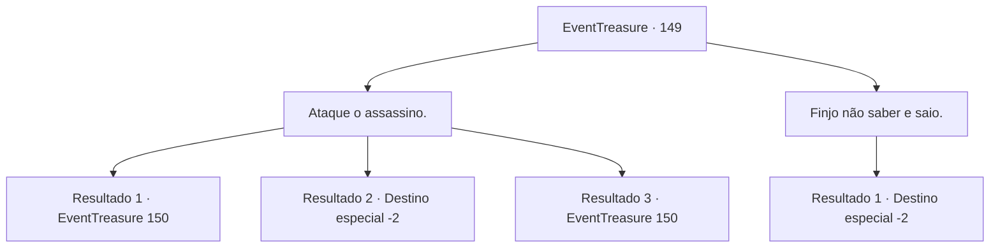

# Eventos de tesouro · 149

[Índice da tabela](index.md) · [Índice geral](../index.md)

ID: `pt:EventTreasure:149` · Fonte: `EventTreasure4` · Versão: 1.2.47.

Mapeamento estático dos arquivos; a disponibilidade e a execução dependem do estado da run.

## Texto do evento

*Sem texto no arquivo.*

## Dados de entrada

```json
{
  "id": 149,
  "grade": 1,
  "place": "",
  "required": ""
}
```

## Mapa das escolhas



## Escolhas e resultados

### Escolha 1

Ataque o assassino.

Requisitos e outros campos da escolha:

```json
{
  "required": ""
}
```

#### Resultado 1.1

Você correu para o assassino e o atacou. Ele rapidamente se virou para desviar do seu ataque, Graças a isso, o Barão Copeny foi poupado. O Barão tossiu e se levantou. e gritou com você 

 "Legal..! Aquele filho da puta! Me mate agora!!"

 Imediatamente depois disso, a adaga de assassino voou em sua direção.

Continuação registrada: [Evento 150](0150.md) na mesma tabela.

```json
{
  "required": "21_6_1",
  "chance": "1|0_6_1",
  "nextEvent": 150,
  "type": 0,
  "reward": "6_0_48",
  "place": 10
}
```

#### Resultado 1.2

Você correu em direção ao Assassino para atacá-lo, mas a distância entre vocês era grande demais. A adaga do Assassino atravessou rapidamente a garganta do Barão Copeny, jorrando sangue vermelho. Logo em seguida, o Assassino se lançou pela janela. Quando você o perseguiu, o Barão agarrou seu tornozelo. 

 "P-por favor... me salve..."

 No entanto, antes que você pudesse fazer qualquer coisa, o Barão expirou, perdendo a vida. Enquanto isso, o Assassino escapou pela janela. Após alguns dias de investigação em Lenoir, você foi finalmente inocentado. O velho mordomo do Barão veio até você. 

 "Bem... é um pouco difícil dizer isso, mas podemos considerar isso como uma lei do retorno. O Barão acumulou muita inimizade. Obrigado por seus esforços. Você pode partir agora."

 Depois de se despedir do mordomo, você deixou Lenoir para trás.

Continuação registrada: [Destino especial `-2`](../destinos-especiais.md).

```json
{
  "required": "21_6_1",
  "chance": "15",
  "nextEvent": -2,
  "type": 1,
  "reward": ""
}
```

#### Resultado 1.3

Você atacou assassino. Ele rapidamente se virou para desviar do seu ataque, Graças a isso, o Barão Copeny foi poupado. O Barão tossiu e se levantou. e gritou com você 

 "Legal..! Aquele filho da puta! Me mate agora!!"

 Imediatamente depois disso, a adaga de assassino voou em sua direção.

Continuação registrada: [Evento 150](0150.md) na mesma tabela.

```json
{
  "required": "20_6_1",
  "chance": "1",
  "nextEvent": 150,
  "type": 2,
  "reward": "6_0_48",
  "place": 10
}
```

### Escolha 2

Finjo não saber e saio.

Requisitos e outros campos da escolha:

```json
{
  "required": ""
}
```

#### Resultado 2.1

Entendo. Você decidiu recuar diante da proposta do assassino e ele assentiu com a cabeça, tirando uma bolsa de couro do peito e jogando-a em sua direção. Parece ser o pagamento pelo acordo aceito. Você pegou a bolsa e saiu silenciosamente do local.

Continuação registrada: [Destino especial `-2`](../destinos-especiais.md).

```json
{
  "required": "",
  "chance": "1",
  "nextEvent": -2,
  "type": 2,
  "reward": "0_4_50|5_500_10"
}
```

## Referências que chegam a este evento

- [Evento 148 · escolha 3 · resultado 1](0148.md#escolha-3)
