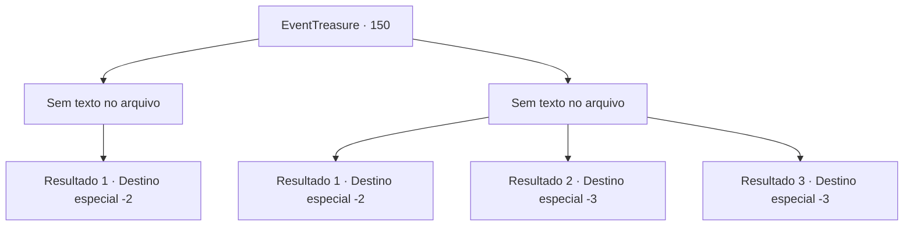

# Eventos de tesouro · 150

[Índice da tabela](index.md) · [Índice geral](../index.md)

ID: `pt:EventTreasure:150` · Fonte: `EventTreasure4` · Versão: 1.2.47.

Mapeamento estático dos arquivos; a disponibilidade e a execução dependem do estado da run.

## Texto do evento

*Sem texto no arquivo.*

## Dados de entrada

```json
{
  "id": 150,
  "grade": 1,
  "place": "",
  "required": ""
}
```

## Mapa das escolhas



## Escolhas e resultados

### Escolha 1

*Sem texto no arquivo; o papel dessa opção depende da interface do jogo.*

Requisitos e outros campos da escolha:

```json
{
  "required": ""
}
```

#### Resultado 1.1

O assassino, que foi derrotado na batalha, fugiu e desapareceu. Você não foi atrás do assassino, mas se aproximou do Barão Copeny. Felizmente, ele não parecia estar gravemente ferido. Naquela época, o Barão Copeny exclamou nervosamente. 

 "Mmm, cara estúpido!! assassino, O assassino veio até o meu quarto! O que diabos você fez!"

 Ele parecia apavorado e fora de si. 

 "O que devo fazer? o que fazer, aquele assassino nunca desistiu de um alvo que almejava. Café gelado..!!"

 Não consegui falar com o assustado Barão Copeny. Naquela época, o velho mordomo do barão chamou os criados e levou o barão. Então ele veio até você e abaixou a cabeça. 

 "Você fez um trabalho muito bom. O barão precisa descansar, então, por favor, saia."

 Você pegou o pagamento que ele lhe deu e saiu de Renozoa.

Continuação registrada: [Destino especial `-2`](../destinos-especiais.md).

```json
{
  "required": "",
  "chance": "1",
  "nextEvent": -2,
  "type": 2,
  "reward": "0_4_100|5_500_10"
}
```

### Escolha 2

*Sem texto no arquivo; o papel dessa opção depende da interface do jogo.*

Requisitos e outros campos da escolha:

```json
{
  "required": ""
}
```

#### Resultado 2.1

Depois de ser derrotado pelo assassino, você fugiu apressadamente. Felizmente, o assassino não perseguiu você e estava focado em matar o alvo original.

Continuação registrada: [Destino especial `-2`](../destinos-especiais.md).

```json
{
  "required": "1_0_2|1_1_2",
  "chance": "1",
  "nextEvent": -2,
  "type": 2,
  "reward": "0_0_-1|0_1_-1|5_500_10"
}
```

#### Resultado 2.2

A adaga azul do assassino se alojou em seu coração. Você morreu quando o mundo ficou vermelho.

Continuação registrada: [Destino especial `-3`](../destinos-especiais.md).

```json
{
  "required": "2_0_2",
  "chance": "1",
  "nextEvent": -3,
  "type": 2,
  "reward": "0_0_-1|0_1_-1"
}
```

#### Resultado 2.3

A adaga azul do assassino se alojou em seu coração. Você morreu quando o mundo ficou vermelho.

Continuação registrada: [Destino especial `-3`](../destinos-especiais.md).

```json
{
  "required": "2_1_2",
  "chance": "1",
  "nextEvent": -3,
  "type": 2,
  "reward": "0_0_-1|0_1_-1"
}
```

## Referências que chegam a este evento

- [Evento 149 · escolha 1 · resultado 1](0149.md#escolha-1)
- [Evento 149 · escolha 1 · resultado 3](0149.md#escolha-1)
