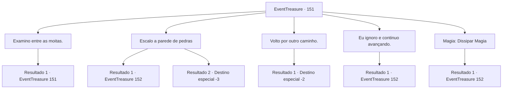

# Eventos de tesouro · 151

[Índice da tabela](index.md) · [Índice geral](../index.md)

ID: `pt:EventTreasure:151` · Fonte: `EventTreasure4` · Versão: 1.2.47.

Mapeamento estático dos arquivos; a disponibilidade e a execução dependem do estado da run.

## Texto do evento

Você estava atravessando a exuberante floresta conhecida como 'Bosque das Folhas Prateadas'. Durante o inverno, as folhas das árvores brilhavam como prata, dando ao bosque seu nome. Além disso, era famoso por ser um parquinho para as fadas. Enquanto caminhava por um bom tempo, você parou de repente. Você tinha chegado a uma estrada sem saída, onde uma enorme parede rochosa bloqueava o caminho. Foi então que você ouviu risadinhas vindo de um arbusto próximo.

## Dados de entrada

```json
{
  "id": 151,
  "grade": 1,
  "place": "",
  "required": "5_502_0"
}
```

## Mapa das escolhas



## Escolhas e resultados

### Escolha 1

Examino entre as moitas.

Requisitos e outros campos da escolha:

```json
{
  "required": "5_502_0"
}
```

#### Resultado 1.1

Você se aproximou cautelosamente e espiou por entre os arbustos. Mas não havia nada entre os arbustos.

Continuação registrada: [Evento 151](0151.md) na mesma tabela.

```json
{
  "required": "",
  "chance": "1",
  "nextEvent": 151,
  "type": 2,
  "reward": "5_502_9"
}
```

### Escolha 2

Escalo a parede de pedras

Requisitos e outros campos da escolha:

```json
{
  "required": ""
}
```

#### Resultado 2.1

Você se aproximou da parede de pedra e cuidadosamente colocou sua mão sobre ela. Nesse momento, a parede de pedra desapareceu e seu corpo se inclinou. A parede de pedra bloqueando o caminho era uma ilusão. De repente, o lugar onde você estava era uma ladeira, então você perdeu o equilíbrio e caiu. 

 "TOC Toc! Olha como fui enganado sem saber que era uma ilusão!"

 "Quão estúpido! Soco!"

 Depois de rolar um pouco na ladeira, você acordou com o som de risadas vindas de algum lugar. Ao olhar em volta, você vê um grupo de ninfas e duendes sorrindo para você.

Continuação registrada: [Evento 152](0152.md) na mesma tabela.

```json
{
  "required": "1_0_2",
  "chance": "1",
  "nextEvent": 152,
  "type": 2,
  "reward": "0_0_-1"
}
```

#### Resultado 2.2

Você se aproximou da parede de pedra e cuidadosamente colocou sua mão sobre ela. Nesse momento, a parede de pedra desapareceu e seu corpo se inclinou. A parede de pedra bloqueando o caminho era uma ilusão. De repente, o lugar onde você estava era uma ladeira, então você perdeu o equilíbrio e caiu. Você bate a cabeça em algum lugar e perde a consciência.

Continuação registrada: [Destino especial `-3`](../destinos-especiais.md).

```json
{
  "required": "2_0_2",
  "chance": "1",
  "nextEvent": -3,
  "type": 2,
  "reward": "0_0_-1"
}
```

### Escolha 3

Volto por outro caminho.

Requisitos e outros campos da escolha:

```json
{
  "required": ""
}
```

#### Resultado 3.1

Você evitou o penhasco e encontrou outro caminho para voltar. Embora tenha ouvido um som provocativo em algum lugar, você optou por ignorá-lo e continuou caminhando.

Continuação registrada: [Destino especial `-2`](../destinos-especiais.md).

```json
{
  "required": "",
  "chance": "1",
  "nextEvent": -2,
  "type": 2,
  "reward": "5_502_10"
}
```

### Escolha 4

Eu ignoro e continuo avançando.

Requisitos e outros campos da escolha:

```json
{
  "required": "1_14_11"
}
```

#### Resultado 4.1

De repente, a parede que apareceu era apenas uma ilusão. Você ignorou a ilusão e avançou cautelosamente. Então, você viu um caminho íngreme descendo abaixo. Você desceu lentamente o caminho íngreme e se deparou com aqueles que criaram a ilusão. Elas eram um grupo de ninfas e fadas. 

 "Oh! Como você percebeu que era uma ilusão?"

 "Você conseguiu descobrir nossa brincadeira..."

 As fadas olharam para você com os olhos arregalados.

Continuação registrada: [Evento 152](0152.md) na mesma tabela.

```json
{
  "required": "",
  "chance": "1",
  "nextEvent": 152,
  "type": 2,
  "reward": ""
}
```

### Escolha 5

Magia: Dissipar Magia

Requisitos e outros campos da escolha:

```json
{
  "required": "20_0_2|1_1_2"
}
```

#### Resultado 5.1

Você lançou um feitiço de Dissipar em direção à parede ilusória. Assim que fez isso, a parede desapareceu e revelou um caminho íngreme descendo. Você desceu cuidadosamente o caminho e se deparou com aqueles que criaram a ilusão. Eles eram um grupo de ninfas e fadas. 

 "Oh! Como você descobriu que era uma ilusão?"

 "Você conseguiu descobrir nossa brincadeira..."

 As fadas olharam para você com os olhos arregalados.

Continuação registrada: [Evento 152](0152.md) na mesma tabela.

```json
{
  "required": "",
  "chance": "1",
  "nextEvent": 152,
  "type": 2,
  "reward": "0_1_-1"
}
```

## Referências que chegam a este evento

- [Evento 151 · escolha 1 · resultado 1](0151.md#escolha-1)
