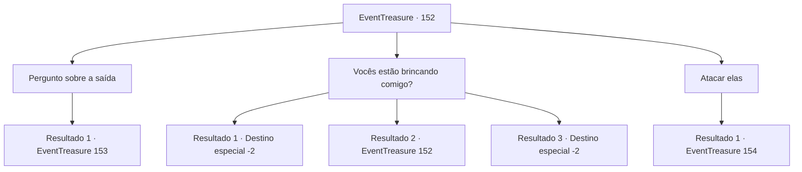

# Eventos de tesouro · 152

[Índice da tabela](index.md) · [Índice geral](../index.md)

ID: `pt:EventTreasure:152` · Fonte: `EventTreasure4` · Versão: 1.2.47.

Mapeamento estático dos arquivos; a disponibilidade e a execução dependem do estado da run.

## Texto do evento

*Sem texto no arquivo.*

## Dados de entrada

```json
{
  "id": 152,
  "grade": 1,
  "place": "",
  "required": ""
}
```

## Mapa das escolhas



## Escolhas e resultados

### Escolha 1

Pergunto sobre a saída

Requisitos e outros campos da escolha:

```json
{
  "required": ""
}
```

#### Resultado 1.1

Você perguntou aos seres mágicos sobre a saída da floresta. Ao ouvirem sua pergunta, o gnomo olhou para os pixies e respondeu com um risinho. 

 "Você quer saber o caminho, não é? Tudo bem, eu vou te contar. Mas há uma condição. Mostre-nos algo divertido! Ainda estamos entediados!"

 O gnomo e os pixies olharam para você com olhares cheios de expectativa.

Continuação registrada: [Evento 153](0153.md) na mesma tabela.

```json
{
  "required": "",
  "chance": "1",
  "nextEvent": 153,
  "type": 2,
  "reward": ""
}
```

### Escolha 2

Vocês estão brincando comigo?

Requisitos e outros campos da escolha:

```json
{
  "required": "5_503_0"
}
```

#### Resultado 2.1

Você ameaçou os seres mágicos, perguntando de onde eles tiraram a coragem para brincar com você. Com um olhar severo, o gnomo começou a tremer e disse: 

 "Desculpe, foi apenas uma brincadeira... Ah, ali! Se você seguir por ali, encontrará a saída da floresta. Sinto muito mesmo..."

 Os seres mágicos, após se desculparem, dispersaram e se esconderam. Você seguiu em direção à saída indicada pelo gnomo.

Continuação registrada: [Destino especial `-2`](../destinos-especiais.md).

```json
{
  "required": "21_1_2",
  "chance": "1|0_12_1",
  "nextEvent": -2,
  "type": 0,
  "reward": "0_2_1|5_502_10"
}
```

#### Resultado 2.2

Você ameaçou os seres mágicos, perguntando de onde eles tiraram coragem para brincar com você. No entanto, os seres mágicos apenas franziram os lábios e resmungaram em resposta. 

 "Você acha que é engraçado brincar assim, né?"

 "Desculpe se acabou se tornando um problema! Já chega disso, tudo bem?"


Continuação registrada: [Evento 152](0152.md) na mesma tabela.

```json
{
  "required": "21_1_2",
  "chance": "13",
  "nextEvent": 152,
  "type": 1,
  "reward": "5_503_1"
}
```

#### Resultado 2.3

Você intimidou os seres mágicos, perguntando de onde eles tiraram coragem para brincar com você. Sob o seu olhar severo, o pequeno ser chamado de 'Nimph' tremeu e disse: 

 "Desculpe, era apenas uma brincadeira... Ah, ali! Se você seguir por lá, encontrará a saída da floresta. Sinto muito mesmo..."

 Os seres mágicos se dispersaram rapidamente, escondendo-se de vista. Você seguiu em direção à saída indicada pelo Nimph.

Continuação registrada: [Destino especial `-2`](../destinos-especiais.md).

```json
{
  "required": "20_1_2",
  "chance": "1",
  "nextEvent": -2,
  "type": 2,
  "reward": "5_502_10"
}
```

### Escolha 3

Atacar elas

Requisitos e outros campos da escolha:

```json
{
  "required": ""
}
```

#### Resultado 3.1

Eu entendo que você está frustrado com as travessuras dos seres mágicos, mas responder com violência não é a melhor solução. Quando você levantou seu punho, os Pixies gritaram e fugiram em pânico. A única criatura que permaneceu no local foi o Nimph. 

 "Você exagerou! Eu estava apenas brincando, não precisava de violência!"

 disse o Nimph com descontentamento, lançando um brilho em sua direção. É importante lembrar que a violência não resolve problemas e é melhor buscar soluções pacíficas para lidar com situações desafiadoras.

Continuação registrada: [Evento 154](0154.md) na mesma tabela.

```json
{
  "required": "",
  "chance": "1",
  "nextEvent": 154,
  "type": 2,
  "reward": "0_3_-1|6_0_32",
  "place": 1
}
```

## Referências que chegam a este evento

- [Evento 151 · escolha 2 · resultado 1](0151.md#escolha-2)
- [Evento 151 · escolha 4 · resultado 1](0151.md#escolha-4)
- [Evento 151 · escolha 5 · resultado 1](0151.md#escolha-5)
- [Evento 152 · escolha 2 · resultado 2](0152.md#escolha-2)
