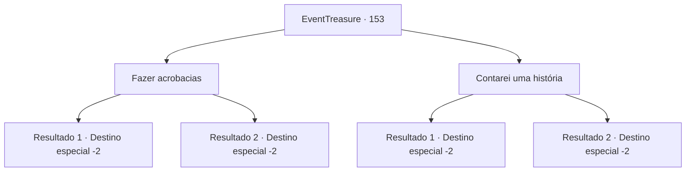

# Eventos de tesouro · 153

[Índice da tabela](index.md) · [Índice geral](../index.md)

ID: `pt:EventTreasure:153` · Fonte: `EventTreasure4` · Versão: 1.2.47.

Mapeamento estático dos arquivos; a disponibilidade e a execução dependem do estado da run.

## Texto do evento

*Sem texto no arquivo.*

## Dados de entrada

```json
{
  "id": 153,
  "grade": 1,
  "place": "",
  "required": ""
}
```

## Mapa das escolhas



## Escolhas e resultados

### Escolha 1

Fazer acrobacias

Requisitos e outros campos da escolha:

```json
{
  "required": ""
}
```

#### Resultado 1.1

Você deu três giros no ar como um salto mortal para trás e pegou uma pedra do chão para malabarismo. Os Nimphs e Pixies aplaudiram animadamente e sorriram radiantes. 

 "Uau! Isso foi incrível!"

 "Como você é tão ágil assim?"

 Assim que a performance terminou, o Nimph se aproximou de você. 

 "Foi realmente divertido. Ah, isso é uma recompensa por nos mostrar suas habilidades acrobáticas. Se você seguir por aquele caminho, encontrará a saída."

 O que o Nimph lhe deu foi um Escudo Místico. Você se despediu dos seres mágicos e seguiu em direção à saída da floresta.

Continuação registrada: [Destino especial `-2`](../destinos-especiais.md).

```json
{
  "required": "",
  "chance": "1|0_6_1",
  "nextEvent": -2,
  "type": 0,
  "reward": "0_2_1|3_96_1|5_502_10"
}
```

#### Resultado 1.2

Você deu um salto mortal para trás e observou a reação dos seres mágicos. Os Nimphs e Pixies te olharam em silêncio por um momento e depois aplaudiram de forma um tanto desajeitada. O Nimph se aproximou de você com uma expressão um pouco desanimada. 

 "Bem, não foi tão divertido, mas você se esforçou. Se você seguir por aquele caminho, encontrará a saída."

 Logo em seguida, os seres mágicos se dispersaram, escondendo-se dos olhos. Você seguiu em direção à saída indicada pelo Nimph.

Continuação registrada: [Destino especial `-2`](../destinos-especiais.md).

```json
{
  "required": "",
  "chance": "13",
  "nextEvent": -2,
  "type": 1,
  "reward": "5_502_10"
}
```

### Escolha 2

Contarei uma história

Requisitos e outros campos da escolha:

```json
{
  "required": ""
}
```

#### Resultado 2.1

Você contou a história de sua aventura com um pouco de exagero. As ninfas e duendes aplaudem sua história e sorriem alegremente. 

 "Uau! Isso é incrível!"

 "Você pensou nisso então!"

 Logo depois que a história acabou, a ninfa se aproximou. 

 "Foi realmente divertido. Ah, isso é um agradecimento por compartilhar suas histórias. Se você seguir por aquele caminho, encontrará a saída."

 O Nimph me entregou um Mystic Shield como um presente. Eu me despedi dos seres mágicos e continuei meu caminho em direção à saída da floresta.

Continuação registrada: [Destino especial `-2`](../destinos-especiais.md).

```json
{
  "required": "",
  "chance": "1|0_12_1",
  "nextEvent": -2,
  "type": 0,
  "reward": "0_2_1|3_96_1|5_502_10"
}
```

#### Resultado 2.2

Eu contei minhas aventuras para os seres mágicos, mas os Pixies começaram a bocejar entediados e a cabeça deles balançava como se estivessem cochilando. O Nimph se aproximou de mim com uma expressão desapontada. 

 "Desculpe, mas podemos parar por aqui. Vamos apenas nos divertir entre nós. A saída está naquela direção, basta seguir em frente."

 Os seres mágicos se dispersaram rapidamente, escondendo-se de vista. Eu segui em direção à saída indicada pelo Nimph.

Continuação registrada: [Destino especial `-2`](../destinos-especiais.md).

```json
{
  "required": "",
  "chance": "13",
  "nextEvent": -2,
  "type": 1,
  "reward": "5_502_10"
}
```

## Referências que chegam a este evento

- [Evento 152 · escolha 1 · resultado 1](0152.md#escolha-1)
