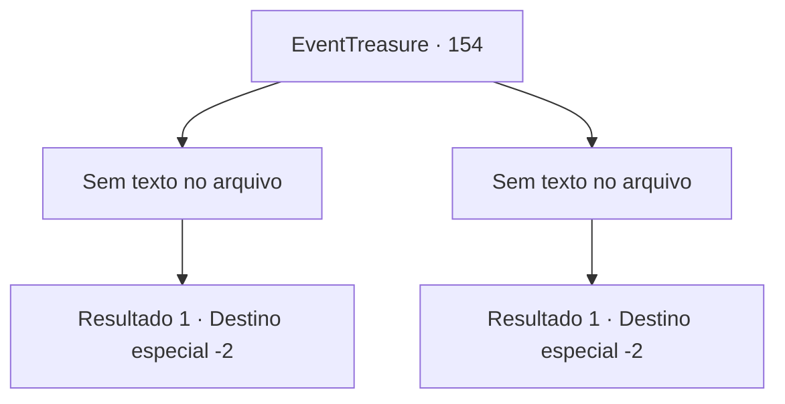

# Eventos de tesouro · 154

[Índice da tabela](index.md) · [Índice geral](../index.md)

ID: `pt:EventTreasure:154` · Fonte: `EventTreasure4` · Versão: 1.2.47.

Mapeamento estático dos arquivos; a disponibilidade e a execução dependem do estado da run.

## Texto do evento

*Sem texto no arquivo.*

## Dados de entrada

```json
{
  "id": 154,
  "grade": 1,
  "place": "",
  "required": ""
}
```

## Mapa das escolhas



## Escolhas e resultados

### Escolha 1

*Sem texto no arquivo; o papel dessa opção depende da interface do jogo.*

Requisitos e outros campos da escolha:

```json
{
  "required": ""
}
```

#### Resultado 1.1

Eu decidi corrigir o hábito do Nimph, então me ajoelhei e pedi a ela para levantar os braços acima da cabeça por trinta minutos. Com um olhar temeroso em minha direção, o Nimph obedientemente ergueu os braços. 

 "Ai, está doendo. Meus joelhos estão doloridos..."

 Ignorando as reclamações do Nimph, perguntei a ela sobre a saída da floresta. Ela apontou para a direção da saída. Instruí o Nimph a abaixar os braços e segui em direção à saída que ela havia indicado.

Continuação registrada: [Destino especial `-2`](../destinos-especiais.md).

```json
{
  "required": "",
  "chance": "1",
  "nextEvent": -2,
  "type": 2,
  "reward": "5_502_10"
}
```

### Escolha 2

*Sem texto no arquivo; o papel dessa opção depende da interface do jogo.*

Requisitos e outros campos da escolha:

```json
{
  "required": ""
}
```

#### Resultado 2.1

Você, que estava em pânico depois de brigar com a fada, fugiu desorientado. Então, quando parou de correr, percebeu que havia saído da Floresta das Folhas de Prata sem perceber.

Continuação registrada: [Destino especial `-2`](../destinos-especiais.md).

```json
{
  "required": "",
  "chance": "1",
  "nextEvent": -2,
  "type": 2,
  "reward": "5_502_10"
}
```

## Referências que chegam a este evento

- [Evento 152 · escolha 3 · resultado 1](0152.md#escolha-3)
