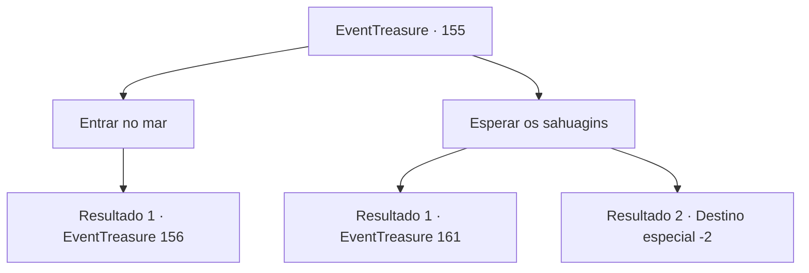

# Eventos de tesouro · 155

[Índice da tabela](index.md) · [Índice geral](../index.md)

ID: `pt:EventTreasure:155` · Fonte: `EventTreasure4` · Versão: 1.2.47.

Mapeamento estático dos arquivos; a disponibilidade e a execução dependem do estado da run.

## Texto do evento

Você chegou à costa onde se diz que está acontecendo uma infestação de sahuagins De acordo com os pescadores locais, desde um grande terremoto ocorrido alguns dias atrás, houve um aumento repentino nas aparições dos sahuagins. Você caminha lentamente pela areia da praia, observando envolta. O som das ondas quebrando ressoa em seus ouvidos.

## Dados de entrada

```json
{
  "id": 155,
  "grade": 1,
  "place": "",
  "required": "5_504_0"
}
```

## Mapa das escolhas



## Escolhas e resultados

### Escolha 1

Entrar no mar

Requisitos e outros campos da escolha:

```json
{
  "required": ""
}
```

#### Resultado 1.1

Você decidiu pular no mar e explorar o fundo do oceano. No entanto, como ainda não avistava criaturas marinhas, sentiu a necessidade de ir mais fundo. Você emergiu brevemente para pegar fôlego antes de mergulhar novamente.

Continuação registrada: [Evento 156](0156.md) na mesma tabela.

```json
{
  "required": "",
  "chance": "1",
  "nextEvent": 156,
  "type": 2,
  "reward": ""
}
```

### Escolha 2

Esperar os sahuagins

Requisitos e outros campos da escolha:

```json
{
  "required": ""
}
```

#### Resultado 2.1

Você montou uma barraca na praia e esperou que as criaturas marinhas aparecessem. Felizmente, não demorou muito para que um grupo de sereias armadas com tridentes surgisse na praia. Elas gritavam em uma língua desconhecida e avançaram em sua direção.

Continuação registrada: [Evento 161](0161.md) na mesma tabela.

```json
{
  "required": "",
  "chance": "1",
  "nextEvent": 161,
  "type": 2,
  "reward": "6_0_13",
  "place": 8
}
```

#### Resultado 2.2

Você montou uma barraca na praia e esperou que as criaturas marinhas aparecessem. No entanto, mesmo após vários dias, as criaturas não surgiram, e você, cansado de esperar, recolheu a barraca e partiu do local.

Continuação registrada: [Destino especial `-2`](../destinos-especiais.md).

```json
{
  "required": "",
  "chance": "1",
  "nextEvent": -2,
  "type": 2,
  "reward": "5_504_10"
}
```

## Referências que chegam a este evento

Nenhum `nextEvent` positivo da mesma tabela aponta para este nó. Isso não prova que seja inacessível: sorteio e estado de história podem selecioná-lo.

