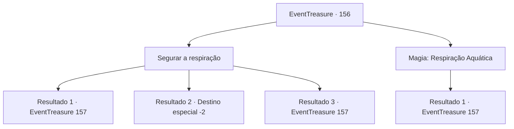

# Eventos de tesouro · 156

[Índice da tabela](index.md) · [Índice geral](../index.md)

ID: `pt:EventTreasure:156` · Fonte: `EventTreasure4` · Versão: 1.2.47.

Mapeamento estático dos arquivos; a disponibilidade e a execução dependem do estado da run.

## Texto do evento

*Sem texto no arquivo.*

## Dados de entrada

```json
{
  "id": 156,
  "grade": 1,
  "place": "",
  "required": ""
}
```

## Mapa das escolhas



## Escolhas e resultados

### Escolha 1

Segurar a respiração

Requisitos e outros campos da escolha:

```json
{
  "required": ""
}
```

#### Resultado 1.1

Ao submergir nas profundezas do mar, você notou que a paisagem em volta foi gradualmente escurecendo à medida que passava por cenários esmeralda. Quanto mais você descia, mais escuro ficava. Você decidiu parar de nadar e olhou ao redor. Em algum momento, você se viu envolvido por uma escuridão tão densa que não conseguia ver nem mesmo um palmo à frente. Para continuar descendo mais fundo, você precisaria de luz.

Continuação registrada: [Evento 157](0157.md) na mesma tabela.

```json
{
  "required": "21_31_1",
  "chance": "1|0_13_1",
  "nextEvent": 157,
  "type": 0,
  "reward": ""
}
```

#### Resultado 1.2

Ao submergir nas profundezas do mar, você notou que, desta vez, uma escuridão absoluta bloqueou o caminho, passando por paisagens esmeralda. Nesse momento, você começou a sentir um aperto no peito, incapaz de segurar a respiração por mais tempo. Imediatamente, você emergiu e respirou novamente, caminhando até a praia. Havia muitos desafios e limitações para explorar as profundezas do mar. Você olhou para o mar agitado, enxugou o corpo e partiu dali.

Continuação registrada: [Destino especial `-2`](../destinos-especiais.md).

```json
{
  "required": "21_31_1",
  "chance": "11",
  "nextEvent": -2,
  "type": 1,
  "reward": "5_504_10"
}
```

#### Resultado 1.3

Você mergulha no mar profundo. você mergulhou nas profundezas do oceano, passando por paisagens esmeralda que gradualmente se tornavam mais escuras.  Você se perguntava até onde havia descido.  Parando de nadar, observou ao seu redor.  Em algum momento, uma escuridão total envolvia você, impedindo que visse até mesmo um palmo à sua frente.  Para continuar descendo ainda mais fundo, você precisava de luz.

Continuação registrada: [Evento 157](0157.md) na mesma tabela.

```json
{
  "required": "20_31_1",
  "chance": "1",
  "nextEvent": 157,
  "type": 2,
  "reward": ""
}
```

### Escolha 2

Magia: Respiração Aquática

Requisitos e outros campos da escolha:

```json
{
  "required": "20_0_2|1_1_2"
}
```

#### Resultado 2.1

Enquanto praticava a respiração subaquática, você mergulhou nas profundezas do oceano, passando por paisagens esmeralda que gradualmente se tornavam mais escuras. Você se perguntava até onde havia descido. Parando de nadar, observou ao seu redor. Em algum momento, uma escuridão total envolvia você, impedindo que visse até mesmo um palmo à sua frente. Para continuar descendo ainda mais fundo, você precisava de luz.

Continuação registrada: [Evento 157](0157.md) na mesma tabela.

```json
{
  "required": "",
  "chance": "1",
  "nextEvent": 157,
  "type": 2,
  "reward": "0_1_-1"
}
```

## Referências que chegam a este evento

- [Evento 155 · escolha 1 · resultado 1](0155.md#escolha-1)
- [Evento 161 · escolha 1 · resultado 1](0161.md#escolha-1)
