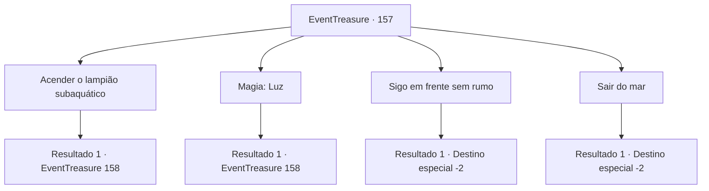

# Eventos de tesouro · 157

[Índice da tabela](index.md) · [Índice geral](../index.md)

ID: `pt:EventTreasure:157` · Fonte: `EventTreasure4` · Versão: 1.2.47.

Mapeamento estático dos arquivos; a disponibilidade e a execução dependem do estado da run.

## Texto do evento

*Sem texto no arquivo.*

## Dados de entrada

```json
{
  "id": 157,
  "grade": 1,
  "place": "",
  "required": ""
}
```

## Mapa das escolhas



## Escolhas e resultados

### Escolha 1

Acender o lampião subaquático

Requisitos e outros campos da escolha:

```json
{
  "required": "8_210_1"
}
```

#### Resultado 1.1

|drawing_dive| Você acende a lâmpada submarina e vai mais fundo no mar. No final da luz, você encontrou um templo subaquático meio desmoronado. Todos os lugares estavam cobertos com pilhas de pedras e terra, e uma estátua de pedra de um tubarão estava alta no centro. Talvez tenha estado submerso por muito tempo. Assim que você estava olhando ao redor do templo submarino, um respingo de água surgiu de repente. Um grande tubarão branco atacou você à distância. Você rapidamente sacou sua arma e enfrentou o ataque do grande tubarão branco.

Continuação registrada: [Evento 158](0158.md) na mesma tabela.

```json
{
  "required": "",
  "chance": "1",
  "nextEvent": 158,
  "type": 2,
  "reward": "6_0_106",
  "place": 3
}
```

### Escolha 2

Magia: Luz

Requisitos e outros campos da escolha:

```json
{
  "required": "20_0_1"
}
```

#### Resultado 2.1

|drawing_dive| Você conjurou uma luz e mergulhou ainda mais fundo no oceano. Enquanto seguia a luz, você descobriu um templo subaquático parcialmente em ruínas. Estava coberto de rochas e montes de terra, e no centro, havia uma estátua de um tubarão, erguendo-se imponente. Provavelmente tinha afundado ali por muito tempo. Enquanto você explorava o templo subaquático, de repente uma tempestade se formou. Um grupo de raias-manta se aproximou correndo de longe e atacou você. Você rapidamente desembainhou sua arma e se defendeu do ataque das raias-manta.

Continuação registrada: [Evento 158](0158.md) na mesma tabela.

```json
{
  "required": "",
  "chance": "1",
  "nextEvent": 158,
  "type": 2,
  "reward": "6_0_106",
  "place": 3
}
```

### Escolha 3

Sigo em frente sem rumo

Requisitos e outros campos da escolha:

```json
{
  "required": ""
}
```

#### Resultado 3.1

Você desafiou a escuridão e desceu sem rumo. Não era possível ver nada à sua frente, e você não tinha ideia de para onde estava indo ou onde estava.

 'Bolhas, bolhas...'

 De repente, uma correnteza violenta se aproximou e envolveu você. Por causa da falta de visibilidade, você não conseguiu reagir e foi arrastado pela correnteza. Você foi levado para algum lugar desconhecido. 

 Depois de um tempo, você chegou a uma costa desconhecida. Como não tinha ideia de onde estava antes, decidiu seguir em outra direção.

Continuação registrada: [Destino especial `-2`](../destinos-especiais.md).

```json
{
  "required": "",
  "chance": "1",
  "nextEvent": -2,
  "type": 2,
  "reward": "5_504_10"
}
```

### Escolha 4

Sair do mar

Requisitos e outros campos da escolha:

```json
{
  "required": ""
}
```

#### Resultado 4.1

Você deixou o lugar sem encontrar a causa frequente da aparição dos Sahuagins.

Continuação registrada: [Destino especial `-2`](../destinos-especiais.md).

```json
{
  "required": "",
  "chance": "1",
  "nextEvent": -2,
  "type": 2,
  "reward": "5_504_10"
}
```

## Referências que chegam a este evento

- [Evento 156 · escolha 1 · resultado 1](0156.md#escolha-1)
- [Evento 156 · escolha 1 · resultado 3](0156.md#escolha-1)
- [Evento 156 · escolha 2 · resultado 1](0156.md#escolha-2)
