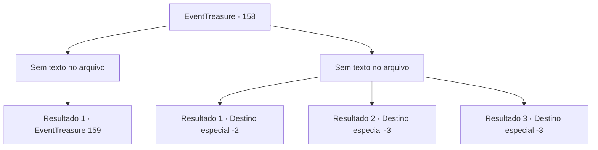

# Eventos de tesouro · 158

[Índice da tabela](index.md) · [Índice geral](../index.md)

ID: `pt:EventTreasure:158` · Fonte: `EventTreasure4` · Versão: 1.2.47.

Mapeamento estático dos arquivos; a disponibilidade e a execução dependem do estado da run.

## Texto do evento

*Sem texto no arquivo.*

## Dados de entrada

```json
{
  "id": 158,
  "grade": 1,
  "place": "",
  "required": ""
}
```

## Mapa das escolhas



## Escolhas e resultados

### Escolha 1

*Sem texto no arquivo; o papel dessa opção depende da interface do jogo.*

Requisitos e outros campos da escolha:

```json
{
  "required": ""
}
```

#### Resultado 1.1

Depois de fatiar o tubarão, você se aproxima de uma estátua de tubarão. Ela tinha uma aparência rudimentar, mas era de tamanho gigantesco, transmitindo uma sensação majestosa. Enquanto contemplava cuidadosamente a estátua, você desviou o olhar para baixo dela. Você viu uma pilha de ouro, parecendo ser oferecida a alguém.

Continuação registrada: [Evento 159](0159.md) na mesma tabela.

```json
{
  "required": "",
  "chance": "1",
  "nextEvent": 159,
  "type": 2,
  "reward": ""
}
```

### Escolha 2

*Sem texto no arquivo; o papel dessa opção depende da interface do jogo.*

Requisitos e outros campos da escolha:

```json
{
  "required": ""
}
```

#### Resultado 2.1

Após o ataque do tubarão, você lembrou vagamente de uma história que ouviu antes. Dizia-se que ao bater no espinho dorsal do tubarão, ele ficaria imóvel por um tempo. Desesperadamente, você golpeou o espinho dorsal do tubarão com força. Para sua surpresa, o tubarão realmente parou de se mover, e você aproveitou essa oportunidade para escapar do mar.

Continuação registrada: [Destino especial `-2`](../destinos-especiais.md).

```json
{
  "required": "1_0_2|1_1_2",
  "chance": "1",
  "nextEvent": -2,
  "type": 2,
  "reward": "0_0_-1|0_1_-1|5_504_10"
}
```

#### Resultado 2.2

Você se tornou o jantar do tubarão.

Continuação registrada: [Destino especial `-3`](../destinos-especiais.md).

```json
{
  "required": "2_0_2",
  "chance": "1",
  "nextEvent": -3,
  "type": 2,
  "reward": "0_0_-1|0_1_-1"
}
```

#### Resultado 2.3

Você se tornou comida do tubarão.

Continuação registrada: [Destino especial `-3`](../destinos-especiais.md).

```json
{
  "required": "2_1_2",
  "chance": "1",
  "nextEvent": -3,
  "type": 2,
  "reward": "0_0_-1|0_1_-1"
}
```

## Referências que chegam a este evento

- [Evento 157 · escolha 1 · resultado 1](0157.md#escolha-1)
- [Evento 157 · escolha 2 · resultado 1](0157.md#escolha-2)
