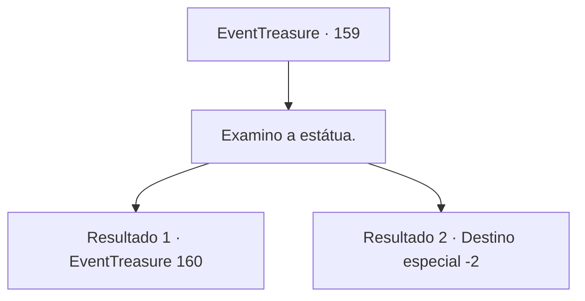

# Eventos de tesouro · 159

[Índice da tabela](index.md) · [Índice geral](../index.md)

ID: `pt:EventTreasure:159` · Fonte: `EventTreasure4` · Versão: 1.2.47.

Mapeamento estático dos arquivos; a disponibilidade e a execução dependem do estado da run.

## Texto do evento

*Sem texto no arquivo.*

## Dados de entrada

```json
{
  "id": 159,
  "grade": 1,
  "place": "",
  "required": ""
}
```

## Mapa das escolhas



## Escolhas e resultados

### Escolha 1

Examino a estátua.

Requisitos e outros campos da escolha:

```json
{
  "required": ""
}
```

#### Resultado 1.1

Você percebeu a verdadeira identidade da estatueta de tubarão. Era uma representação do deus-tubarão, adorada pelos sahuagins. Ao compreender esse fato, você também entendeu a razão pela qual os sahuagins frequentemente apareciam neste local. Quando a estátua da divindade tubarão surgiu, os sahuagins que a descobriram começaram a vir aqui com mais frequência. Era evidente que o templo subaquático e a estátua emergiram devido às repercussões de um terremoto recente. Os montes de terra espalhados pelo templo e o ouro acumulado sob a estátua eram provas disso. Você examinou novamente a estátua da divindade dos tubarões e o templo subaquático. Para reduzir a frequência de aparições dos Sahuagins nas praias próximas, você percebeu que precisava sabotar o motivo deles virem até aqui.

Continuação registrada: [Evento 160](0160.md) na mesma tabela.

```json
{
  "required": "",
  "chance": "1|0_7_1",
  "nextEvent": 160,
  "type": 0,
  "reward": ""
}
```

#### Resultado 1.2

Após pensar muito, você não conseguiu entender a verdadeira identidade da estátua de tubarão. Você também não conseguiu descobrir a razão pela qual os Sahagins apareciam com frequência. Sentindo apenas dor de cabeça sem obter respostas, você decidiu parar de pensar e pegou o ouro. Então, habilmente nadou de volta à superfície da água.

Continuação registrada: [Destino especial `-2`](../destinos-especiais.md).

```json
{
  "required": "",
  "chance": "8",
  "nextEvent": -2,
  "type": 1,
  "reward": "0_4_80|5_504_10"
}
```

## Referências que chegam a este evento

- [Evento 158 · escolha 1 · resultado 1](0158.md#escolha-1)
