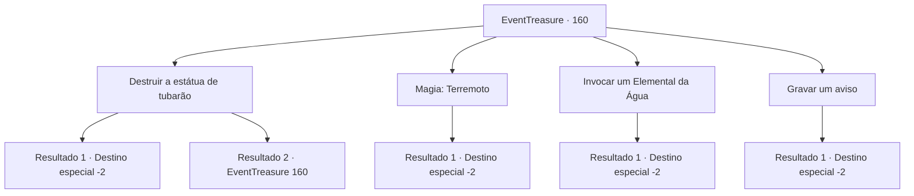

# Eventos de tesouro · 160

[Índice da tabela](index.md) · [Índice geral](../index.md)

ID: `pt:EventTreasure:160` · Fonte: `EventTreasure4` · Versão: 1.2.47.

Mapeamento estático dos arquivos; a disponibilidade e a execução dependem do estado da run.

## Texto do evento

*Sem texto no arquivo.*

## Dados de entrada

```json
{
  "id": 160,
  "grade": 1,
  "place": "",
  "required": ""
}
```

## Mapa das escolhas



## Escolhas e resultados

### Escolha 1

Destruir a estátua de tubarão

Requisitos e outros campos da escolha:

```json
{
  "required": "5_505_0"
}
```

#### Resultado 1.1

Você pegou o ouro que estava debaixo da estátua de tubarão. Em seguida, você golpeou a estátua com força. Com seu ataque, a estátua desmoronou completamente e se tornou irreconhecível. Ao ver essa cena, você nadou rapidamente e saiu dali.

Continuação registrada: [Destino especial `-2`](../destinos-especiais.md).

```json
{
  "required": "",
  "chance": "1|0_5_1",
  "nextEvent": -2,
  "type": 0,
  "reward": "0_2_1|0_4_80|5_504_10"
}
```

#### Resultado 1.2

Você balançou sua arma com força, atacando a estátua de tubarão. No entanto, devido à sua movimentação na água, seus movimentos estavam mais lentos do que o habitual e a estátua de tubarão não se quebrou. Você olhou para a estátua de tubarão intacta e decidiu tentar uma abordagem diferente.

Continuação registrada: [Evento 160](0160.md) na mesma tabela.

```json
{
  "required": "",
  "chance": "11",
  "nextEvent": 160,
  "type": 1,
  "reward": "5_505_1"
}
```

### Escolha 2

Magia: Terremoto

Requisitos e outros campos da escolha:

```json
{
  "required": "20_0_3|1_1_2"
}
```

#### Resultado 2.1

Você pegou o ouro debaixo da estátua de tubarão e, em seguida, saiu do templo e lançou um feitiço. 

 'Truuuuum!!' 

 Um estrondo ressoou e o templo submarino desmoronou completamente. Ao ver essa cena, você nadou rapidamente para longe dali.

Continuação registrada: [Destino especial `-2`](../destinos-especiais.md).

```json
{
  "required": "",
  "chance": "1",
  "nextEvent": -2,
  "type": 2,
  "reward": "0_2_1|0_1_-1|0_4_80|5_504_10"
}
```

### Escolha 3

Invocar um Elemental da Água

Requisitos e outros campos da escolha:

```json
{
  "required": "8_192_1"
}
```

#### Resultado 3.1

Você é o mestre das águas e desencadeou o poder de um Elemental Aquático. Com o ouro em mãos, você convocou o Elemental e imediatamente ele começou a controlar as correntes do mar. Um turbilhão se formou ao redor do templo, e logo, com um estrondo ensurdecedor, ele desmoronou. Você deixou para trás os escombros do templo em ruínas e partiu.

Continuação registrada: [Destino especial `-2`](../destinos-especiais.md).

```json
{
  "required": "",
  "chance": "1",
  "nextEvent": -2,
  "type": 2,
  "reward": "0_2_1|0_4_80|5_504_10"
}
```

### Escolha 4

Gravar um aviso

Requisitos e outros campos da escolha:

```json
{
  "required": ""
}
```

#### Resultado 4.1

Você pegou o ouro que estava abaixo da estátua do tubarão. Em seguida, você gravou um aviso na estátua e partiu do local. Você não tinha certeza se aqueles que encontrassem o aviso entenderiam ou se teria algum efeito, mas decidiu tentar mesmo assim.

Continuação registrada: [Destino especial `-2`](../destinos-especiais.md).

```json
{
  "required": "",
  "chance": "1",
  "nextEvent": -2,
  "type": 2,
  "reward": "0_4_80|5_504_10"
}
```

## Referências que chegam a este evento

- [Evento 159 · escolha 1 · resultado 1](0159.md#escolha-1)
- [Evento 160 · escolha 1 · resultado 2](0160.md#escolha-1)
