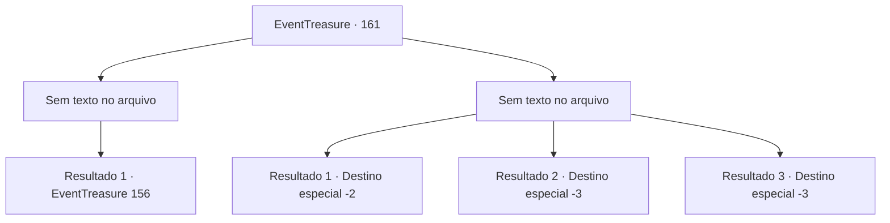

# Eventos de tesouro · 161

[Índice da tabela](index.md) · [Índice geral](../index.md)

ID: `pt:EventTreasure:161` · Fonte: `EventTreasure4` · Versão: 1.2.47.

Mapeamento estático dos arquivos; a disponibilidade e a execução dependem do estado da run.

## Texto do evento

*Sem texto no arquivo.*

## Dados de entrada

```json
{
  "id": 161,
  "grade": 1,
  "place": "",
  "required": ""
}
```

## Mapa das escolhas



## Escolhas e resultados

### Escolha 1

*Sem texto no arquivo; o papel dessa opção depende da interface do jogo.*

Requisitos e outros campos da escolha:

```json
{
  "required": ""
}
```

#### Resultado 1.1

Você derrotou os Sahuagins que estavam te atacando, mas um deles conseguiu escapar saltando no mar. Sem hesitar, você também pulou na água para persegui-lo. No entanto, o sáhuagin desapareceu rapidamente nas profundezas do oceano, deixando você para trás. Para continuar a perseguição, você precisaria ir ainda mais fundo e considerar uma maneira de recuperar o fôlego.

Continuação registrada: [Evento 156](0156.md) na mesma tabela.

```json
{
  "required": "",
  "chance": "1",
  "nextEvent": 156,
  "type": 2,
  "reward": ""
}
```

### Escolha 2

*Sem texto no arquivo; o papel dessa opção depende da interface do jogo.*

Requisitos e outros campos da escolha:

```json
{
  "required": ""
}
```

#### Resultado 2.1

Você não conseguiu lidar com os sáhuagins e decidiu fugir do local. Felizmente, eles não eram tão rápidos em terra firme, o que permitiu que você escapasse da perseguição.

Continuação registrada: [Destino especial `-2`](../destinos-especiais.md).

```json
{
  "required": "1_0_2|1_1_2",
  "chance": "1",
  "nextEvent": -2,
  "type": 2,
  "reward": "0_0_-1|0_1_-1|5_504_10"
}
```

#### Resultado 2.2

Depois de ser derrotado por Sahuagins, você experimentou seus métodos em primeira mão. Caiu no mar e virou comida de peixe.

Continuação registrada: [Destino especial `-3`](../destinos-especiais.md).

```json
{
  "required": "2_0_2",
  "chance": "1",
  "nextEvent": -3,
  "type": 2,
  "reward": "0_0_-1|0_1_-1"
}
```

#### Resultado 2.3

Depois de ser derrotado por Sahuagins, você experimentou seus métodos em primeira mão. Caiu no mar e se tornou refeição de peixe.

Continuação registrada: [Destino especial `-3`](../destinos-especiais.md).

```json
{
  "required": "2_1_2",
  "chance": "1",
  "nextEvent": -3,
  "type": 2,
  "reward": "0_0_-1|0_1_-1"
}
```

## Referências que chegam a este evento

- [Evento 155 · escolha 2 · resultado 1](0155.md#escolha-2)
