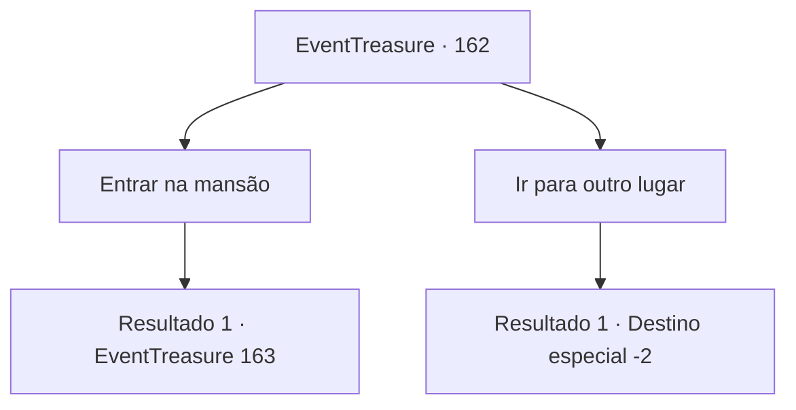

# Eventos de tesouro · 162

[Índice da tabela](index.md) · [Índice geral](../index.md)

ID: `pt:EventTreasure:162` · Fonte: `EventTreasure4` · Versão: 1.2.47.

Mapeamento estático dos arquivos; a disponibilidade e a execução dependem do estado da run.

## Texto do evento

|drawing_abandonedMansion| Apenas a luz do luar iluminava o céu escuro da noite. Enquanto você vagava em busca de um lugar para descansar, encontrou uma mansão antiga e parou de caminhar. Nas janelas da mansão, não havia nem mesmo um raio de luz, apenas plantas secas cobrindo as paredes. O som do vento uivando parecia um grito em seus ouvidos.

## Dados de entrada

```json
{
  "id": 162,
  "grade": 1,
  "place": "",
  "required": "18_242_1|5_506_0|1_2_15"
}
```

## Mapa das escolhas



## Escolhas e resultados

### Escolha 1

Entrar na mansão

Requisitos e outros campos da escolha:

```json
{
  "required": ""
}
```

#### Resultado 1.1

Você entrou na mansão. O interior estava cheio de ar frio, mas felizmente havia uma lareira. Você se aproximou da lareira e acendeu o fogo. Não demorou muito para o calor reconfortante derreter seu corpo gelado. 

 "Hmm... Aah..."

 Foi nesse exato momento que um gemido estranho veio das escadas que levavam ao segundo andar.

Continuação registrada: [Evento 163](0163.md) na mesma tabela.

```json
{
  "required": "",
  "chance": "1",
  "nextEvent": 163,
  "type": 2,
  "reward": ""
}
```

### Escolha 2

Ir para outro lugar

Requisitos e outros campos da escolha:

```json
{
  "required": ""
}
```

#### Resultado 2.1

Você decidiu partir em busca de outro lugar para descansar.

Continuação registrada: [Destino especial `-2`](../destinos-especiais.md).

```json
{
  "required": "",
  "chance": "1",
  "nextEvent": -2,
  "type": 2,
  "reward": "5_506_10"
}
```

## Referências que chegam a este evento

Nenhum `nextEvent` positivo da mesma tabela aponta para este nó. Isso não prova que seja inacessível: sorteio e estado de história podem selecioná-lo.

