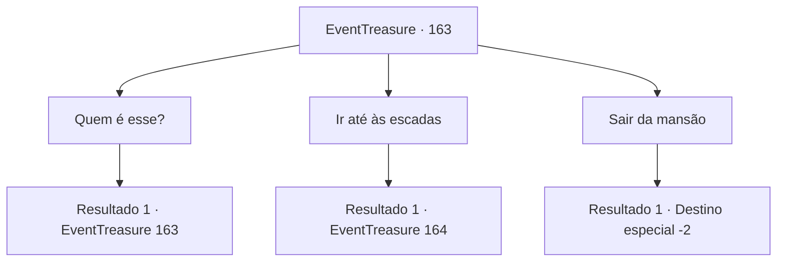

# Eventos de tesouro · 163

[Índice da tabela](index.md) · [Índice geral](../index.md)

ID: `pt:EventTreasure:163` · Fonte: `EventTreasure4` · Versão: 1.2.47.

Mapeamento estático dos arquivos; a disponibilidade e a execução dependem do estado da run.

## Texto do evento

*Sem texto no arquivo.*

## Dados de entrada

```json
{
  "id": 163,
  "grade": 1,
  "place": "",
  "required": ""
}
```

## Mapa das escolhas



## Escolhas e resultados

### Escolha 1

Quem é esse?

Requisitos e outros campos da escolha:

```json
{
  "required": "5_507_0"
}
```

#### Resultado 1.1

Alguém no segundo andar não respondeu à sua pergunta. Você lentamente pegou uma arma em suas mãos e se levantou. 

 ".......Eu, e-eu vou..."

 Nesse momento, a voz rouca de um homem ressoou novamente, parecendo gemer.

Continuação registrada: [Evento 163](0163.md) na mesma tabela.

```json
{
  "required": "",
  "chance": "1",
  "nextEvent": 163,
  "type": 2,
  "reward": "5_507_1"
}
```

### Escolha 2

Ir até às escadas

Requisitos e outros campos da escolha:

```json
{
  "required": ""
}
```

#### Resultado 2.1

Com cautela, você caminhou em direção às escadas. O assoalho antigo rangeu sob seus passos, e um vento frio percorreu a mansão. 

 "Aaahhhh!!"

 No instante em que você estava prestes a subir as escadas, alguém se lançou em sua direção, emitindo um grito estridente. Seus dentes manchados de sangue visaram o seu pescoço.

Continuação registrada: [Evento 164](0164.md) na mesma tabela.

```json
{
  "required": "",
  "chance": "1",
  "nextEvent": 164,
  "type": 2,
  "reward": "6_0_129",
  "place": 10
}
```

### Escolha 3

Sair da mansão

Requisitos e outros campos da escolha:

```json
{
  "required": ""
}
```

#### Resultado 3.1

Sentindo uma sensação sinistra, você rapidamente deixou a mansão.

Continuação registrada: [Destino especial `-2`](../destinos-especiais.md).

```json
{
  "required": "",
  "chance": "1",
  "nextEvent": -2,
  "type": 2,
  "reward": "5_506_10"
}
```

## Referências que chegam a este evento

- [Evento 162 · escolha 1 · resultado 1](0162.md#escolha-1)
- [Evento 163 · escolha 1 · resultado 1](0163.md#escolha-1)
