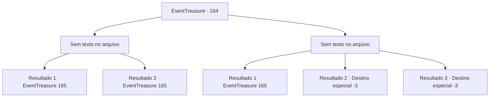

# Eventos de tesouro · 164

[Índice da tabela](index.md) · [Índice geral](../index.md)

ID: `pt:EventTreasure:164` · Fonte: `EventTreasure4` · Versão: 1.2.47.

Mapeamento estático dos arquivos; a disponibilidade e a execução dependem do estado da run.

## Texto do evento

*Sem texto no arquivo.*

## Dados de entrada

```json
{
  "id": 164,
  "grade": 1,
  "place": "",
  "required": ""
}
```

## Mapa das escolhas



## Escolhas e resultados

### Escolha 1

*Sem texto no arquivo; o papel dessa opção depende da interface do jogo.*

Requisitos e outros campos da escolha:

```json
{
  "required": ""
}
```

#### Resultado 1.1

Apesar de ter sofrido ferimentos fatais, o indivíduo se ergueu de forma grotesca e se lançou novamente em sua direção. 

 "Aaahhhh!!"

 Em um momento de desespero, uma janela foi quebrada e a própria janela se lançou em direção à cabeça do indivíduo, reduzindo-a a pedaços. Em seguida, o homem, com a cabeça destroçada, foi consumido pelas chamas e desapareceu instantaneamente. 

 "Você está ferido?"

 Uma mulher que se aproximou perguntou enquanto olhava para você.

Continuação registrada: [Evento 165](0165.md) na mesma tabela.

```json
{
  "required": "24_2_1",
  "chance": "1",
  "nextEvent": 165,
  "type": 2,
  "reward": ""
}
```

#### Resultado 1.2

Você balançou sua arma e quebrou a cabeça do homem. Então, o homem cuja cabeça foi esmagada queimou e desapareceu em um instante. Nesse momento, a porta da mansão se abriu e uma mulher entrou. Ela olhou para frente e para trás entre as cinzas no chão e você, então perguntou com um olhar preocupado. 

 "Você está ferido em algum lugar?"


Continuação registrada: [Evento 165](0165.md) na mesma tabela.

```json
{
  "required": "23_2_1",
  "chance": "1",
  "nextEvent": 165,
  "type": 2,
  "reward": ""
}
```

### Escolha 2

*Sem texto no arquivo; o papel dessa opção depende da interface do jogo.*

Requisitos e outros campos da escolha:

```json
{
  "required": ""
}
```

#### Resultado 2.1

O homem atacou você como um animal. Então, ele agarrou você com muita força e enfiou a boca em direção à sua nuca. 

 "Kyaaaaaaa!!"

 Naquele momento de desespero, a janela foi quebrada e a lança voou direto para dentro e quebrou a cabeça do homem. Então, o homem cuja cabeça foi esmagada queimou e desapareceu em um instante. 

 "Você está ferido em algum lugar?"

 De repente, uma mulher se aproximou e olhou para você.

Continuação registrada: [Evento 165](0165.md) na mesma tabela.

```json
{
  "required": "1_0_2|1_1_2",
  "chance": "1",
  "nextEvent": 165,
  "type": 2,
  "reward": "0_0_-1|0_1_-1"
}
```

#### Resultado 2.2

A presa que perfurou seu pescoço sugou seu sangue. A ganância do indivíduo em relação ao sangue continuou até você morrer.

Continuação registrada: [Destino especial `-3`](../destinos-especiais.md).

```json
{
  "required": "2_0_2",
  "chance": "1",
  "nextEvent": -3,
  "type": 2,
  "reward": "0_0_-1|0_1_-1"
}
```

#### Resultado 2.3

A presa que perfurou seu pescoço sugou seu sangue. A ganância do indivíduo em relação ao sangue continuou até você morrer.

Continuação registrada: [Destino especial `-3`](../destinos-especiais.md).

```json
{
  "required": "2_1_2",
  "chance": "1",
  "nextEvent": -3,
  "type": 2,
  "reward": "0_0_-1|0_1_-1"
}
```

## Referências que chegam a este evento

- [Evento 163 · escolha 2 · resultado 1](0163.md#escolha-2)
