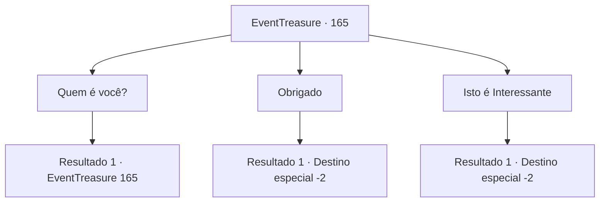

# Eventos de tesouro · 165

[Índice da tabela](index.md) · [Índice geral](../index.md)

ID: `pt:EventTreasure:165` · Fonte: `EventTreasure4` · Versão: 1.2.47.

Mapeamento estático dos arquivos; a disponibilidade e a execução dependem do estado da run.

## Texto do evento

*Sem texto no arquivo.*

## Dados de entrada

```json
{
  "id": 165,
  "grade": 1,
  "place": "",
  "required": ""
}
```

## Mapa das escolhas



## Escolhas e resultados

### Escolha 1

Quem é você?

Requisitos e outros campos da escolha:

```json
{
  "required": "5_508_0"
}
```

#### Resultado 1.1

À sua pergunta, ela respondeu enquanto examinava as cinzas. 

 "Eu sou uma mercenária pertencente a 'Ziwa Mercenarie'. Parece que você foi atacado por ele... mas estou feliz que você parece estar bem."

 Segundo a mulher, Jiwa e os Mercenários eram um grupo especializado em caçar vampiros. Ela estendeu a mão para confirmar algo. Assim que você segurou a mão dela, sentiu uma sensação de formigamento nas palmas. Olhando para a palma, havia uma única gota de sangue. 

 "desculpe. É porque você pode ser infectado sem saber e se tornar uma cria de vampiro. Tenha certeza de que você não está infectado."


Continuação registrada: [Evento 165](0165.md) na mesma tabela.

```json
{
  "required": "",
  "chance": "1",
  "nextEvent": 165,
  "type": 2,
  "reward": "5_508_1"
}
```

### Escolha 2

Obrigado

Requisitos e outros campos da escolha:

```json
{
  "required": "5_508_1"
}
```

#### Resultado 2.1

Você agradeceu à mulher enquanto observava a palma da sua mão. Em resposta, ela apenas balançou a cabeça, como se não fosse nada, e partiu da mansão. Parecia que ela precisava se apressar para caçar outro vampiro. Você olhou ao redor da mansão mais uma vez. O fogo na lareira havia se apagado, e não parecia mais um lugar adequado para descansar. Você preparou seus pertences e deixou a mansão em silêncio.

Continuação registrada: [Destino especial `-2`](../destinos-especiais.md).

```json
{
  "required": "",
  "chance": "1",
  "nextEvent": -2,
  "type": 2,
  "reward": "5_506_10"
}
```

### Escolha 3

Isto é Interessante

Requisitos e outros campos da escolha:

```json
{
  "required": "5_508_1"
}
```

#### Resultado 3.1

Você expressou interesse em ouvir mais, pedindo que ela compartilhasse mais histórias. No entanto, ela recusou firmemente com uma expressão determinada. 

 "Caçar vampiros é uma tarefa extremamente perigosa. A menos que haja circunstâncias especiais, é melhor não se interessar por isso."

 Ela deu um breve aceno de cabeça antes de deixar a mansão. Você olhou ao redor mais uma vez, percebendo que o fogo na lareira havia se apagado e não era mais um espaço acolhedor. Preparando seus pertences, você partiu da mansão que havia se tornado silenciosa.

Continuação registrada: [Destino especial `-2`](../destinos-especiais.md).

```json
{
  "required": "",
  "chance": "1",
  "nextEvent": -2,
  "type": 2,
  "reward": "5_506_10"
}
```

## Referências que chegam a este evento

- [Evento 164 · escolha 1 · resultado 1](0164.md#escolha-1)
- [Evento 164 · escolha 1 · resultado 2](0164.md#escolha-1)
- [Evento 164 · escolha 2 · resultado 1](0164.md#escolha-2)
- [Evento 165 · escolha 1 · resultado 1](0165.md#escolha-1)
