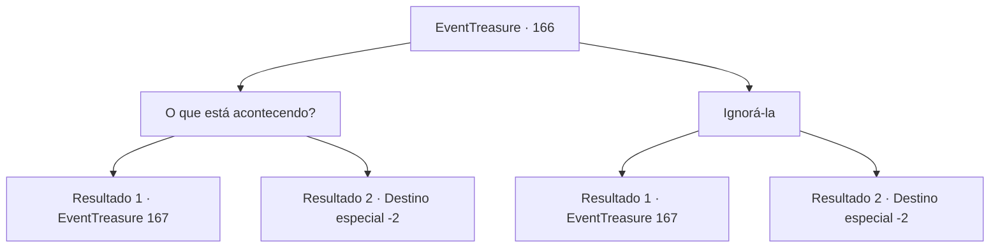

# Eventos de tesouro · 166

[Índice da tabela](index.md) · [Índice geral](../index.md)

ID: `pt:EventTreasure:166` · Fonte: `EventTreasure4` · Versão: 1.2.47.

Mapeamento estático dos arquivos; a disponibilidade e a execução dependem do estado da run.

## Texto do evento

Você está cruzando uma selva chamada ‘Andaria’. Intensa umidade,o chão se degrada, e todos os tipos de insetos voadores te incomodam. Certa hora, uma idosa aparece do nada, atrapalhando seu caminho. Ela começa a te olhar da cabeça aos pés. Ela tem desenhos tribais feitos com tinta branca por todo o corpo, está vestida de roupas feitas de ossos, couro de animais e plantas

## Dados de entrada

```json
{
  "id": 166,
  "grade": 2,
  "place": "",
  "required": "5_512_0|1_2_50|18_513_1|18_514_1|26_9_1|18_699_1"
}
```

## Mapa das escolhas



## Escolhas e resultados

### Escolha 1

O que está acontecendo?

Requisitos e outros campos da escolha:

```json
{
  "required": ""
}
```

#### Resultado 1.1

A anciã te olha fixamente com olhos verde-claros e te diz: 

 "Você é o escolhido. Gostaria de conhecer a serpente divina?"


Continuação registrada: [Evento 167](0167.md) na mesma tabela.

```json
{
  "required": "20_1_2",
  "chance": "1",
  "nextEvent": 167,
  "type": 2,
  "reward": ""
}
```

#### Resultado 1.2

A anciã olha fixamente para você com olhos verde-claros e diz: 

 "Hmm... Você não é o escolhido. Ainda não está pronto para conhecer a serpente divina. Você não representa nenhuma ameaça... de forma alguma."

 Com isso, ela desaparece entre os arbustos.

Continuação registrada: [Destino especial `-2`](../destinos-especiais.md).

```json
{
  "required": "21_1_2",
  "chance": "1",
  "nextEvent": -2,
  "type": 2,
  "reward": "5_512_9"
}
```

### Escolha 2

Ignorá-la

Requisitos e outros campos da escolha:

```json
{
  "required": ""
}
```

#### Resultado 2.1

Você ignora a anciã e continua em seu caminho. Então, a anciã de repente começa a falar contigo. 

 "Criança. Gostaria de conhecer o deus das serpentes?"


Continuação registrada: [Evento 167](0167.md) na mesma tabela.

```json
{
  "required": "20_1_2",
  "chance": "1",
  "nextEvent": 167,
  "type": 2,
  "reward": ""
}
```

#### Resultado 2.2

Você ignora a anciã e continua em seu caminho. Em seguida, a mulher desaparece entre os arbustos.

Continuação registrada: [Destino especial `-2`](../destinos-especiais.md).

```json
{
  "required": "21_1_2",
  "chance": "1",
  "nextEvent": -2,
  "type": 2,
  "reward": "5_512_9"
}
```

## Referências que chegam a este evento

Nenhum `nextEvent` positivo da mesma tabela aponta para este nó. Isso não prova que seja inacessível: sorteio e estado de história podem selecioná-lo.

