# Eventos de tesouro · 167

[Índice da tabela](index.md) · [Índice geral](../index.md)

ID: `pt:EventTreasure:167` · Fonte: `EventTreasure4` · Versão: 1.2.47.

Mapeamento estático dos arquivos; a disponibilidade e a execução dependem do estado da run.

## Texto do evento

*Sem texto no arquivo.*

## Dados de entrada

```json
{
  "id": 167,
  "grade": 1,
  "place": "",
  "required": ""
}
```

## Mapa das escolhas

```mermaid
flowchart TD
  E["EventTreasure · 167"]
  C0["Quem é você?"]
  E --> C0
  R0_0["Resultado 1 · EventTreasure 167"]
  C0 --> R0_0
  C1["Perguntar o que é o &#x27;Deus-Serpente&#x27;"]
  E --> C1
  R1_0["Resultado 1 · EventTreasure 167"]
  C1 --> R1_0
  C2["Por quê eu deveria conhecer o Deus-Serpente?"]
  E --> C2
  R2_0["Resultado 1 · EventTreasure 168"]
  C2 --> R2_0
```



## Escolhas e resultados

### Escolha 1

Quem é você?

Requisitos e outros campos da escolha:

```json
{
  "required": "5_523_0"
}
```

#### Resultado 1.1

Você pede à idosa que revele sua identidade. Ela então sorri com rugas ao redor dos lábios. 

 "Haha. Você deve ter ficado surpreso porque eu te abordei de repente. Eu sou a chefe 'Ines' da tribo 'Amari' que vive nesta selva. É um prazer conhecê-lo, viajante."

 Ela também menciona que sabia que você ia vir graças aos arranjos do 'deus serpente'.

Continuação registrada: [Evento 167](0167.md) na mesma tabela.

```json
{
  "required": "",
  "chance": "1",
  "nextEvent": 167,
  "type": 2,
  "reward": "5_523_1"
}
```

### Escolha 2

Perguntar o que é o 'Deus-Serpente'

Requisitos e outros campos da escolha:

```json
{
  "required": "5_524_0"
}
```

#### Resultado 2.1

Você pergunta a ela o que é o 'deus serpente' ao qual ela se refere. Então ela aponta para a selva com o dedo e responde. 

 "O deus serpente é o guardião da selva. Ele governa o ecossistema desta selva, cuida de nós para que possamos permanecer nela. Desde que tudo esteja equilibrado."


Continuação registrada: [Evento 167](0167.md) na mesma tabela.

```json
{
  "required": "",
  "chance": "1",
  "nextEvent": 167,
  "type": 2,
  "reward": "5_524_1"
}
```

### Escolha 3

Por quê eu deveria conhecer o Deus-Serpente?

Requisitos e outros campos da escolha:

```json
{
  "required": "5_524_1|5_523_1"
}
```

#### Resultado 3.1

A idosa balança a cabeça em resposta à sua pergunta. 

 "Não posso te dizer agora. Vamos para a cidade, pois o sol logo se porá."

 Enquanto diz isso, ela tenta puxar seu pulso.

Continuação registrada: [Evento 168](0168.md) na mesma tabela.

```json
{
  "required": "",
  "chance": "1",
  "nextEvent": 168,
  "type": 2,
  "reward": ""
}
```

## Referências que chegam a este evento

- [Evento 166 · escolha 1 · resultado 1](0166.md#escolha-1)
- [Evento 166 · escolha 2 · resultado 1](0166.md#escolha-2)
- [Evento 167 · escolha 1 · resultado 1](0167.md#escolha-1)
- [Evento 167 · escolha 2 · resultado 1](0167.md#escolha-2)
