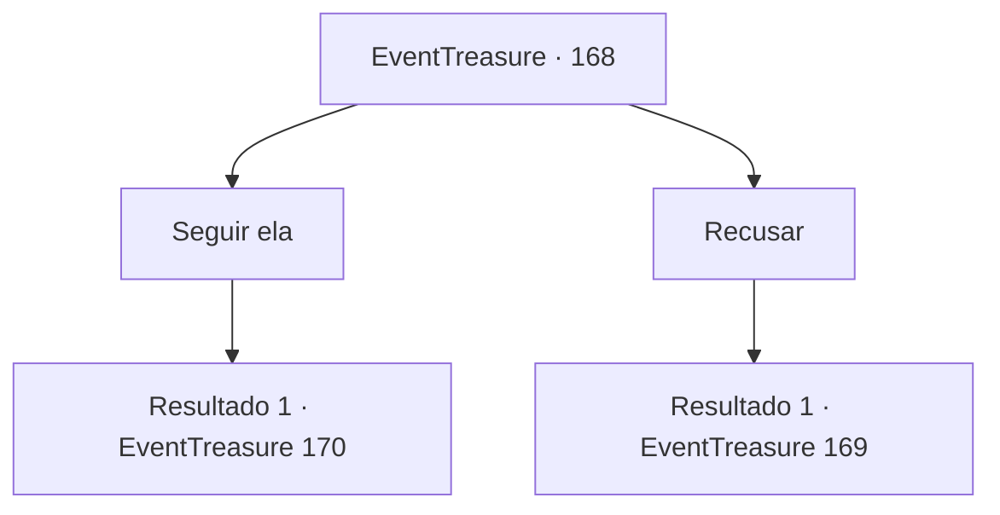

# Eventos de tesouro · 168

[Índice da tabela](index.md) · [Índice geral](../index.md)

ID: `pt:EventTreasure:168` · Fonte: `EventTreasure4` · Versão: 1.2.47.

Mapeamento estático dos arquivos; a disponibilidade e a execução dependem do estado da run.

## Texto do evento

*Sem texto no arquivo.*

## Dados de entrada

```json
{
  "id": 168,
  "grade": 1,
  "place": "",
  "required": ""
}
```

## Mapa das escolhas



## Escolhas e resultados

### Escolha 1

Seguir ela

Requisitos e outros campos da escolha:

```json
{
  "required": ""
}
```

#### Resultado 1.1

Decide seguir a anciã. Os arbustos da selva se abrem e um caminho se revela conforme vocês caminham. Depois de caminhar por vários minutos, uma pequena vila aparece em frente. Na vila com várias cabanas de madeira, há esculturas em forma de serpente por todos os lados, e os moradores também usam roupas feitas de ossos e couro de animais. Eles não estão muito surpresos em te ver, mesmo sendo forasteiro. Enquanto você está olhando ao redor da vila, uma menina se aproxima e abraça a anciã. 

 "Oi, senhora!"

 A anciã acaricia suavemente a cabeça da menina. Então ela diz para trazer algo para comer para o convidado. A menina corre para algum lugar e a idosa te convida a entrar em sua casa. A anciã entra na pequena cabana feita de árvores e grama e repousa no carpete. Então ela te diz enquanto acende uma folha enrolada em fogo. 

 "A serpente divina disse que está preocupada."


Continuação registrada: [Evento 170](0170.md) na mesma tabela.

```json
{
  "required": "",
  "chance": "1",
  "nextEvent": 170,
  "type": 2,
  "reward": ""
}
```

### Escolha 2

Recusar

Requisitos e outros campos da escolha:

```json
{
  "required": ""
}
```

#### Resultado 2.1

Você recusa a oferta da mulher anciã. A anciã diz enquanto inclina a cabeça. 

 "Hmm... Sério? Então... Deixe-me te dizer algo de um coração ansioso. Apresse-se, pois o sol logo se porá. A selva é perigosa à noite."

 A mulher idosa caminha apressadamente em direção ao interior da floresta.

Continuação registrada: [Evento 169](0169.md) na mesma tabela.

```json
{
  "required": "",
  "chance": "1",
  "nextEvent": 169,
  "type": 2,
  "reward": ""
}
```

## Referências que chegam a este evento

- [Evento 167 · escolha 3 · resultado 1](0167.md#escolha-3)
