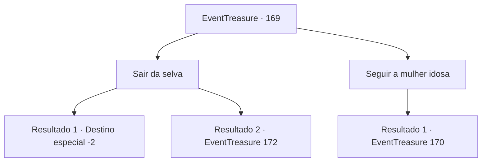

# Eventos de tesouro · 169

[Índice da tabela](index.md) · [Índice geral](../index.md)

ID: `pt:EventTreasure:169` · Fonte: `EventTreasure4` · Versão: 1.2.47.

Mapeamento estático dos arquivos; a disponibilidade e a execução dependem do estado da run.

## Texto do evento

*Sem texto no arquivo.*

## Dados de entrada

```json
{
  "id": 169,
  "grade": 1,
  "place": "",
  "required": ""
}
```

## Mapa das escolhas



## Escolhas e resultados

### Escolha 1

Sair da selva 

Requisitos e outros campos da escolha:

```json
{
  "required": ""
}
```

#### Resultado 1.1

Você escapa com sucesso da selva antes do pôr do sol, lembrando o caminho pelo qual entrou.

Continuação registrada: [Destino especial `-2`](../destinos-especiais.md).

```json
{
  "required": "",
  "chance": "1|0_7_1",
  "nextEvent": -2,
  "type": 0,
  "reward": "5_512_9"
}
```

#### Resultado 1.2

Você tenta sair pelo mesmo caminho que entrou, mas se perde, e eventualmente vagueia até que a escuridão cubra a selva. O terreno escorregadio e o ar úmido parecem drenar sua energia, e você decide apoiar-se em uma árvore para descansar. No entanto, vários olhos se iluminam na escuridão como se estivessem esperando por esse momento. 

 "Ahh! Kyahh!"

 São Goblins Macacos. Imediatamente você corrige sua postura e começa a lutar contra os goblins macacos que caem das árvores sobre sua cabeça.

Continuação registrada: [Evento 172](0172.md) na mesma tabela.

```json
{
  "required": "",
  "chance": "16",
  "nextEvent": 172,
  "type": 2,
  "reward": "6_3_7",
  "place": 1
}
```

### Escolha 2

Seguir a mulher idosa

Requisitos e outros campos da escolha:

```json
{
  "required": ""
}
```

#### Resultado 2.1

Decide seguir a mulher idosa. Os arbustos da selva se abrem e um caminho se abre ao lado de seus passos. Depois de caminhar por vários minutos, uma pequena vila aparece diante de você. Na vila, com várias cabanas de madeira, há esculturas em forma de serpente por toda parte, e os habitantes também usam roupas feitas de ossos e couro de animais. Eles estão um pouco surpresos em te ver, que é estrangeiro. No entanto, a mulher idosa te convida para sua casa. A mulher idosa entra na pequena cabana feita de árvores e grama e se deita no tapete. Então ela te conta enquanto acende uma folha enrolada em fogo. 

 "O deus serpente diz que está preocupado neste momento."


Continuação registrada: [Evento 170](0170.md) na mesma tabela.

```json
{
  "required": "",
  "chance": "1",
  "nextEvent": 170,
  "type": 2,
  "reward": ""
}
```

## Referências que chegam a este evento

- [Evento 168 · escolha 2 · resultado 1](0168.md#escolha-2)
