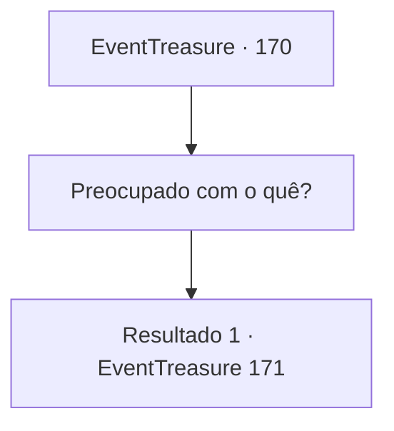

# Eventos de tesouro · 170

[Índice da tabela](index.md) · [Índice geral](../index.md)

ID: `pt:EventTreasure:170` · Fonte: `EventTreasure4` · Versão: 1.2.47.

Mapeamento estático dos arquivos; a disponibilidade e a execução dependem do estado da run.

## Texto do evento

*Sem texto no arquivo.*

## Dados de entrada

```json
{
  "id": 170,
  "grade": 1,
  "place": "",
  "required": ""
}
```

## Mapa das escolhas



## Escolhas e resultados

### Escolha 1

Preocupado com o quê?

Requisitos e outros campos da escolha:

```json
{
  "required": ""
}
```

#### Resultado 1.1

A anciã não pode responder à sua pergunta. Ela apenas menciona que não sabe exatamente do que Deus está preocupado. 

 "No entanto, a profecia que recebi era trazer o 'predador'. E no momento em que te vi, pensei que você era um ser que parecia um predador."

 A anciã, que parou de falar, começa a aspirar a fumaça da folha seca. E exala e continua. 

 "Está tarde, então vamos ver juntos a serpente divina amanhã quando o dia estiver brilhante."

 Nesse momento, entra uma menina. Ela está segurando uma tigela feita de folhas largas, e nela há lagartixas bem cozidas, lagartas gordinhas e um duende macaco. 

 "Agora, coma algo. Não posso deixar um convidado sair de estômago vazio."


Continuação registrada: [Evento 171](0171.md) na mesma tabela.

```json
{
  "required": "",
  "chance": "1",
  "nextEvent": 171,
  "type": 2,
  "reward": ""
}
```

## Referências que chegam a este evento

- [Evento 168 · escolha 1 · resultado 1](0168.md#escolha-1)
- [Evento 169 · escolha 2 · resultado 1](0169.md#escolha-2)
