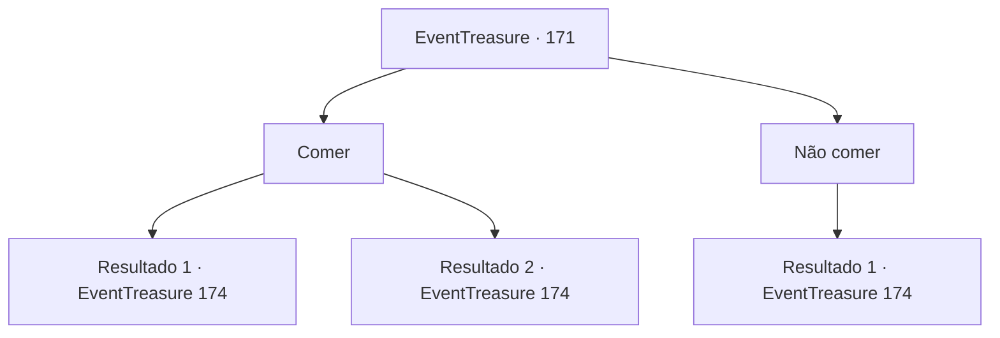

# Eventos de tesouro · 171

[Índice da tabela](index.md) · [Índice geral](../index.md)

ID: `pt:EventTreasure:171` · Fonte: `EventTreasure4` · Versão: 1.2.47.

Mapeamento estático dos arquivos; a disponibilidade e a execução dependem do estado da run.

## Texto do evento

*Sem texto no arquivo.*

## Dados de entrada

```json
{
  "id": 171,
  "grade": 1,
  "place": "",
  "required": ""
}
```

## Mapa das escolhas



## Escolhas e resultados

### Escolha 1

Comer

Requisitos e outros campos da escolha:

```json
{
  "required": ""
}
```

#### Resultado 1.1

Você come a 'comida' que ela está te oferecendo. Sabe melhor do que parece. O lagarto cozido tem gosto de frango, as lagartas são como queijo e o macaco duende também tem um gosto bastante bom. Ines te olha com um sorriso orgulhoso. 

 "Você deveria dormir aqui e partir pela manhã porque o sol já se pôs."

 Depois de dizer isso, Ines vai embora com a menina. Você tenta dormir no tapete áspero. 

 Pela manhã, você e Ines vão ao altar da serpente deus. Vocês encontram um altar construído em cima de uma rocha gigante depois de chegarem ao centro da selva. É uma escada que se estreita para baixo de todos os lados, com esculturas de serpentes por toda parte, e no fundo há um buraco gigante. Ines junta as mãos e reza em frente ao altar. Depois de murmurar algo por um momento, ela levanta a cabeça e fala. 

 "Agora vou embora. Você deveria solicitar uma audiência com o deus serpente."

 Depois de falar, ela te deixa para trás e retorna à vila.

Continuação registrada: [Evento 174](0174.md) na mesma tabela.

```json
{
  "required": "",
  "chance": "1|0_13_1",
  "nextEvent": 174,
  "type": 0,
  "reward": "0_0_1|0_13_1"
}
```

#### Resultado 1.2

Tentas comer a 'comida' que ela te oferece. No entanto, assim que colocas a lagarta na boca, não consegues conter a sensação de náusea. Enquanto estás a vomitar o ácido do teu estômago, Ines fala contigo enquanto te dá palmadinhas nas costas. 

 "Oh, não... Não deves estar bem. Devias ter-me dito antes. Devias dormir aqui e partir de manhã porque o sol já se pôs."

 Depois de dizer isso, Ines vai embora com a rapariga. Tentas adormecer no tapete áspero. 

 De manhã, tu e Ines vão ao altar da serpente deus. Encontras um altar construído em cima de uma rocha gigante depois de chegarem ao centro da selva. É uma escadaria que estreita para baixo de todos os lados, com esculturas de serpentes por todo o lado, e no fundo há um buraco gigante. Ines junta as mãos e reza em frente ao altar. Depois de murmurar algo por um momento, ela levanta a cabeça e fala. 

 "Vou voltar agora. Deves solicitar uma audiência com o deus serpente."

 Depois de falar, ela deixa-te para trás e regressa à aldeia.

Continuação registrada: [Evento 174](0174.md) na mesma tabela.

```json
{
  "required": "",
  "chance": "14",
  "nextEvent": 174,
  "type": 1,
  "reward": ""
}
```

### Escolha 2

Não comer

Requisitos e outros campos da escolha:

```json
{
  "required": ""
}
```

#### Resultado 2.1

Inés continua oferecendo comida, mas fica desapontada porque você recusa. 

 "Bem... Tudo bem. Acho que não dá para evitar... Você deveria dormir aqui e partir pela manhã, pois o sol já se pôs."

 Depois de dizer isso, Inés vai embora com a garota. Você tenta dormir no tapete áspero. 

 Pela manhã, você e Inés vão ao altar da serpente deus. Vocês encontram um altar construído em cima de uma rocha gigante depois de chegarem ao centro da selva. É uma escada que se estreita para baixo de todos os lados, com esculturas de serpentes por toda parte, e no fundo há um buraco gigante. Inés junta as mãos e reza em frente ao altar. Depois de murmurar algo por um momento, ela levanta a cabeça e fala. 

 "Vou voltar agora. Você deveria solicitar uma audiência com o deus serpente."

 Depois de falar, ela te deixa para trás e retorna à vila.

Continuação registrada: [Evento 174](0174.md) na mesma tabela.

```json
{
  "required": "",
  "chance": "1",
  "nextEvent": 174,
  "type": 2,
  "reward": ""
}
```

## Referências que chegam a este evento

- [Evento 170 · escolha 1 · resultado 1](0170.md#escolha-1)
