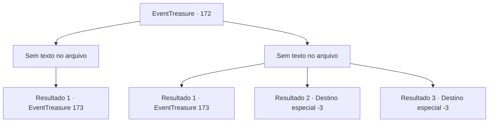

# Eventos de tesouro · 172

[Índice da tabela](index.md) · [Índice geral](../index.md)

ID: `pt:EventTreasure:172` · Fonte: `EventTreasure4` · Versão: 1.2.47.

Mapeamento estático dos arquivos; a disponibilidade e a execução dependem do estado da run.

## Texto do evento

*Sem texto no arquivo.*

## Dados de entrada

```json
{
  "id": 172,
  "grade": 1,
  "place": "",
  "required": ""
}
```

## Mapa das escolhas



## Escolhas e resultados

### Escolha 1

*Sem texto no arquivo; o papel dessa opção depende da interface do jogo.*

Requisitos e outros campos da escolha:

```json
{
  "required": ""
}
```

#### Resultado 1.1

Enquanto você recupera o fôlego, outro predador aparece. 

 "¡Shaa!"

 A serpente gigante que desce da árvore te ataca com sua boca aberta de par em par.

Continuação registrada: [Evento 173](0173.md) na mesma tabela.

```json
{
  "required": "",
  "chance": "1",
  "nextEvent": 173,
  "type": 2,
  "reward": "6_0_63",
  "place": 1
}
```

### Escolha 2

*Sem texto no arquivo; o papel dessa opção depende da interface do jogo.*

Requisitos e outros campos da escolha:

```json
{
  "required": ""
}
```

#### Resultado 2.1

Você escapa dos goblins macacos que estão se apressando. Depois de correr sem pensar, você percebe como a selva ficou silenciosa. Então você encontra outro predador. 

 "¡Shaa!"

 A serpente gigante que desce da árvore te ataca com sua boca aberta de par em par.

Continuação registrada: [Evento 173](0173.md) na mesma tabela.

```json
{
  "required": "1_0_2|1_1_2",
  "chance": "1",
  "nextEvent": 173,
  "type": 2,
  "reward": "6_0_63|0_0_-1|0_1_-1",
  "place": 1
}
```

#### Resultado 2.2

Os duendes macacos enfraquecem lentamente a sua saúde ao se moverem entre as árvores e as lianas. Em seguida, finalmente, eles golpeiam o seu pescoço com uma espada dobrada.

Continuação registrada: [Destino especial `-3`](../destinos-especiais.md).

```json
{
  "required": "2_0_2",
  "chance": "1",
  "nextEvent": -3,
  "type": 2,
  "reward": "0_0_-1|0_1_-1"
}
```

#### Resultado 2.3

Os duendes macacos enfraquecem lentamente a sua saúde ao se moverem entre as árvores e as lianas. Em seguida, finalmente, eles golpeiam o seu pescoço com uma espada dobrada.

Continuação registrada: [Destino especial `-3`](../destinos-especiais.md).

```json
{
  "required": "2_1_2",
  "chance": "1",
  "nextEvent": -3,
  "type": 2,
  "reward": "0_0_-1|0_1_-1"
}
```

## Referências que chegam a este evento

- [Evento 169 · escolha 1 · resultado 2](0169.md#escolha-1)
