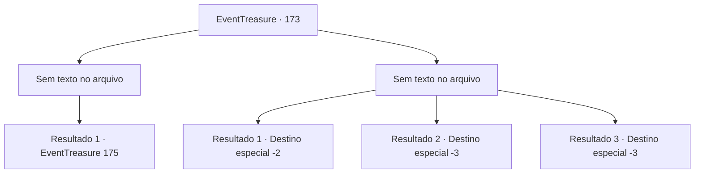

# Eventos de tesouro · 173

[Índice da tabela](index.md) · [Índice geral](../index.md)

ID: `pt:EventTreasure:173` · Fonte: `EventTreasure4` · Versão: 1.2.47.

Mapeamento estático dos arquivos; a disponibilidade e a execução dependem do estado da run.

## Texto do evento

*Sem texto no arquivo.*

## Dados de entrada

```json
{
  "id": 173,
  "grade": 1,
  "place": "",
  "required": ""
}
```

## Mapa das escolhas



## Escolhas e resultados

### Escolha 1

*Sem texto no arquivo; o papel dessa opção depende da interface do jogo.*

Requisitos e outros campos da escolha:

```json
{
  "required": ""
}
```

#### Resultado 1.1

A selva volta a ficar em silêncio depois de derrotar a serpente gigante. Após soltar um suspiro profundo, de repente você sente que a selva está se movendo. Logo percebe que não era apenas uma sensação. Uma serpente enorme, muito maior do que a serpente gigante anterior, emerge da escuridão da selva. |drawing_snakeGod| A serpente parece estar enroscada na selva, com suas escamas marrons e musgo verde por todo o corpo. Ela te encara com olhos brilhantes e aterrorizantes.

Continuação registrada: [Evento 175](0175.md) na mesma tabela.

```json
{
  "required": "",
  "chance": "1",
  "nextEvent": 175,
  "type": 2,
  "reward": ""
}
```

### Escolha 2

*Sem texto no arquivo; o papel dessa opção depende da interface do jogo.*

Requisitos e outros campos da escolha:

```json
{
  "required": ""
}
```

#### Resultado 2.1

Sales correndo o mais rápido que podes da enorme serpente. Depois de correr o mais rápido que podes, percebes que saíste da selva.

Continuação registrada: [Destino especial `-2`](../destinos-especiais.md).

```json
{
  "required": "1_0_2|1_1_2",
  "chance": "1",
  "nextEvent": -2,
  "type": 2,
  "reward": "0_0_-1|0_1_-1|5_512_9"
}
```

#### Resultado 2.2

A enorme cobra se enrola em volta do seu pescoço e começa a estrangulá-lo. Uma pressão imensa é aplicada e pouco depois você perde a consciência com o som de ossos se quebrando.

Continuação registrada: [Destino especial `-3`](../destinos-especiais.md).

```json
{
  "required": "2_0_2",
  "chance": "1",
  "nextEvent": -3,
  "type": 2,
  "reward": "0_0_-1|0_1_-1"
}
```

#### Resultado 2.3

A enorme cobra se enrola em volta do seu pescoço e começa a estrangulá-lo. Uma pressão imensa é aplicada e pouco depois você perde a consciência com o som de ossos se quebrando.

Continuação registrada: [Destino especial `-3`](../destinos-especiais.md).

```json
{
  "required": "2_1_2",
  "chance": "1",
  "nextEvent": -3,
  "type": 2,
  "reward": "0_0_-1|0_1_-1"
}
```

## Referências que chegam a este evento

- [Evento 172 · escolha 1 · resultado 1](0172.md#escolha-1)
- [Evento 172 · escolha 2 · resultado 1](0172.md#escolha-2)
