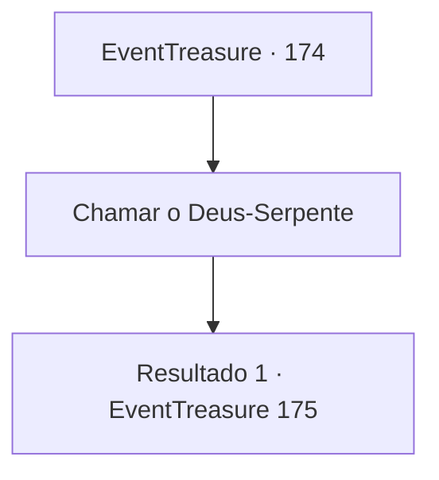

# Eventos de tesouro · 174

[Índice da tabela](index.md) · [Índice geral](../index.md)

ID: `pt:EventTreasure:174` · Fonte: `EventTreasure4` · Versão: 1.2.47.

Mapeamento estático dos arquivos; a disponibilidade e a execução dependem do estado da run.

## Texto do evento

*Sem texto no arquivo.*

## Dados de entrada

```json
{
  "id": 174,
  "grade": 1,
  "place": "",
  "required": ""
}
```

## Mapa das escolhas



## Escolhas e resultados

### Escolha 1

Chamar o Deus-Serpente

Requisitos e outros campos da escolha:

```json
{
  "required": ""
}
```

#### Resultado 1.1

Você chama o deus serpente com todas as suas forças. Quando o eco da sua voz ressoa por toda a selva, logo surge uma serpente gigante do buraco na parte inferior do altar. |drawing_snakeGod| A serpente parece estar enroscada na selva, com suas escamas marrons e musgo verde por todo o corpo. Ela te encara fixamente com olhos brilhantes e aterrorizantes.

Continuação registrada: [Evento 175](0175.md) na mesma tabela.

```json
{
  "required": "",
  "chance": "1",
  "nextEvent": 175,
  "type": 2,
  "reward": ""
}
```

## Referências que chegam a este evento

- [Evento 171 · escolha 1 · resultado 1](0171.md#escolha-1)
- [Evento 171 · escolha 1 · resultado 2](0171.md#escolha-1)
- [Evento 171 · escolha 2 · resultado 1](0171.md#escolha-2)
